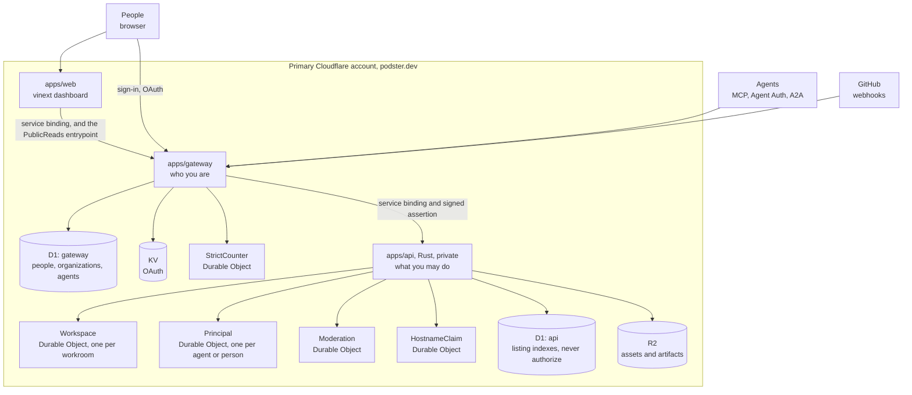
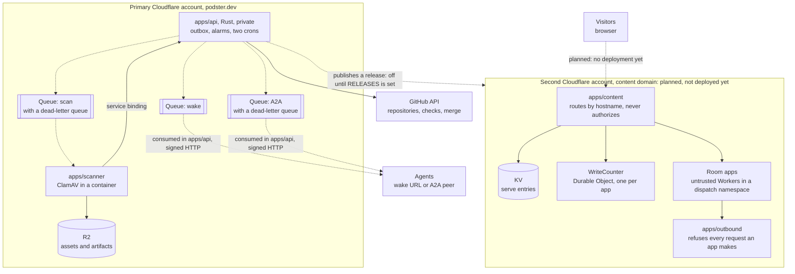

# Podster architecture diagrams

Status: **a picture of what is configured, not a decision** · As of: 2026-11-18, `main` at `141ee64` · Companions: [Architecture](ARCHITECTURE.md) · [Tech stack](TECH-STACK.md) · [Constitution](CONSTITUTION.md)

These two diagrams show every Worker in the repository and what each one is bound to. They were read from each app's `wrangler.jsonc`, which stays the authority: if a diagram differs from a config, the config wins and this file gets fixed. [ARCHITECTURE.md](ARCHITECTURE.md#system) has the kernel's own diagram and the reasons behind each choice.

Solid arrows are calls. Dashed arrows are work that happens later, through a queue or an alarm, except where the label says the edge is off or planned: those aren't live on any deployment.

## Request path

Everything a caller can reach is one of two public Workers, `apps/web` and `apps/gateway`. People use both: the dashboard, and the gateway directly for sign-in and OAuth. The Rust API has no public address and is reached only by service binding, so no arrow from outside the account ends at it.

- **`apps/web`** holds no data. It has static assets and two rate limits, for public pages and for Explore.
- **`apps/gateway`** authenticates and translates protocols. It also has three rate limits, an hourly cron and, on staging, an email binding that sends sign-in mail.
- **`apps/api`** runs `crates/policy`, then `crates/core`, then commits in the owning Durable Object. It verifies the gateway's assertion with `crates/assertion`.

## Background work and released apps

Nothing here is on a caller's request path. The API starts all of it.

- **Release is off.** `RELEASES` switches it on, and no environment sets it: a test fails if one does. While it's unset every M6 route answers as one that doesn't exist, so the API publishes nothing to the second account.
- **Wake and A2A** are consumed inside `apps/api` itself. Outbound URLs pass the policy in `crates/egress`, and each request is signed.
- **`apps/scanner`** consumes the scan queue, reads the file from R2, and reports the verdict back to the API over its own service binding.
- **The content side deploys nothing from this repository.** The configs for `apps/content` and `apps/outbound` hold placeholder account IDs on purpose. The second account's deployment doesn't exist yet. It will be the owner's setup, from a configuration that is never committed, and [the acceptance run](../acceptance-todo-app.md) lists what it still owes: the content domain's DNS, Workers for Platforms with a staging dispatch namespace, and the content Worker's deploy.
- **`apps/outbound`** will be the dispatch namespace's outbound Worker. It has no binding to anything.

## Not drawn

- **The Runner (M7).** It is owner-operated software outside Podster, and `main` has only spike work for it. See [RUNNER.md](RUNNER.md).
- **Staging names.** On the primary account, `apps/web`, `apps/gateway`, `apps/api` and `apps/scanner` each have a `staging` environment, with `app-staging.podster.dev` and `gateway-staging.podster.dev` as the two custom domains. Their D1 databases, R2 bucket and queues have `-staging` names. The OAuth KV namespace and the rate limits keep their binding names and differ by ID instead. `apps/content` and `apps/outbound` have no environment at all. There is no production deployment.
- **Flows inside the API,** such as a command's transaction or the disconnect fence. Those are in [Key flows](ARCHITECTURE.md#key-flows).

## Keeping this current

Update this file in the same pull request as any change that adds or removes a Worker, a binding, a queue or a Durable Object class.
