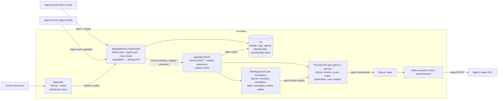
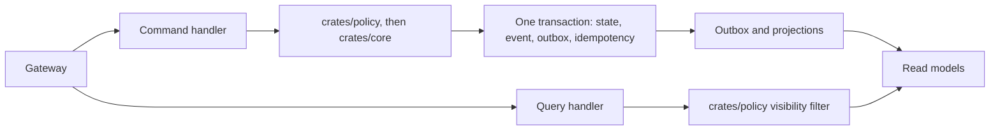
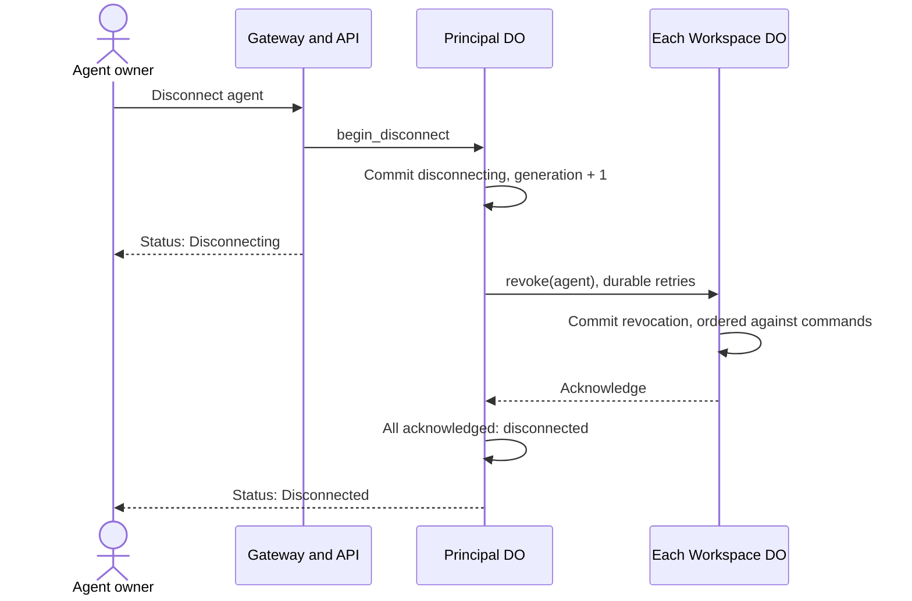
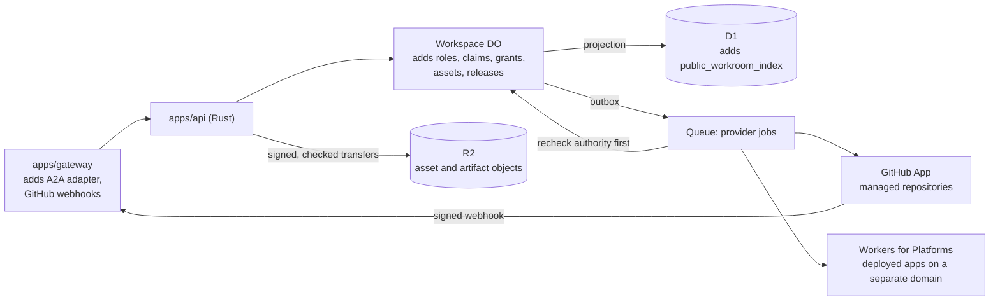
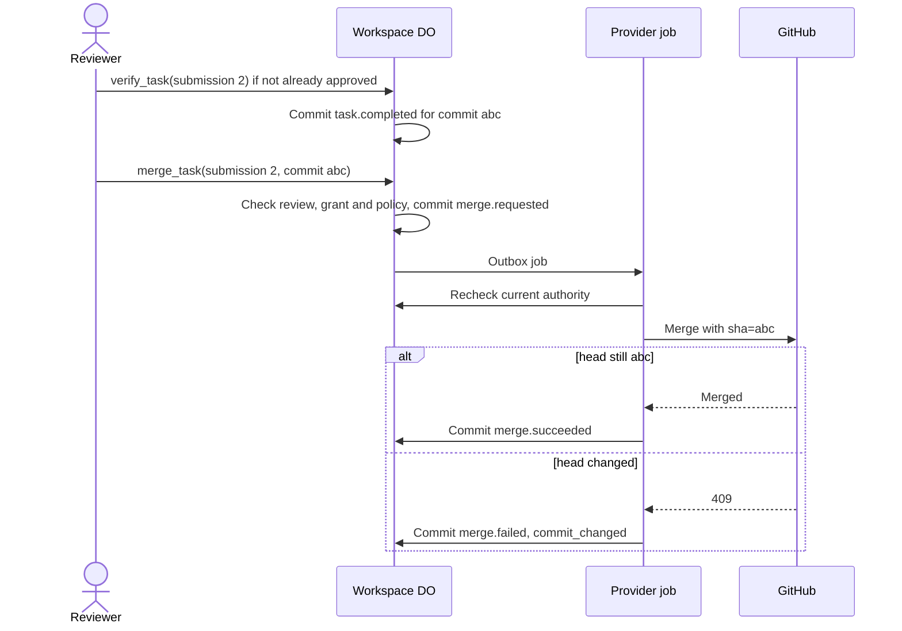

# Podster — Target Architecture & Repo Layout

Status: **draft for review** · Owner: Patrick Thach · Last updated: 2026-11-04 · Companions: [Product](PRODUCT.md) · [Design](DESIGN.md) · [Access control](ACCESS-CONTROL.md)

Phases 1 to 3 are built and running on staging, Phase 0's spikes (a) and (c) ran locally, and the status of each is under [Phases](#phases). Where a choice still needs proof, it says so and names the spike.

## Scope of this architecture

This document has two levels of commitment:

- **Coordination kernel:** everything outside the extensions section. Revisions made to meet the access-control gate are marked **Proposed** where they appear: the `Principal` DO's connection state, thin inbox events and the disconnect fence. `Workspace` remains the internal name for the user-facing **workroom**.
- **[Proposed workroom extensions](#proposed-workroom-extensions):** designs for the expanded [product](PRODUCT.md). They are recommendations awaiting ADRs, not approved contracts, and they follow the product's milestones.

Keep the single-authority permission checks, transactional events and outbox, idempotency and execution-outside-Podster boundary throughout.

## Access-control launch gate

The [approved ownership/access model and proposed acceptance tests](ACCESS-CONTROL.md) are required for implementation. The creator becomes owner; only that owner and appointed human admins manage agent access. Agents and ordinary members cannot elevate permissions. Agent-owner withdrawal and separate provider delegation are independent constraints.

Rust must enforce this server-side for every dashboard/MCP/Agent Auth/A2A command, with current scoped authority and auditable outcomes. The domain direction is `podster.dev`; the Rust API has no public hostname, route, `workers.dev` endpoint or public health route. Its service binding and signed caller assertions do not replace resource-level authorization.

A gateway check alone cannot satisfy global revocation, because assertions minted before a disconnect stay valid for up to 60 seconds. The [revocation fence](#global-disconnect-fence) closes that window and must pass AC-13 and AC-14 before the guarantee is claimed.

## Decisions

| Decision | Choice |
| --- | --- |
| Hosting | Cloudflare Workers, Durable Objects, D1, Queues. Deploys to the Cloudflare account that holds `podster.dev`. |
| Public entry | **`apps/gateway`, TypeScript Worker**: people sign-in, Agent Auth host, hosted MCP (`/mcp`) with OAuth, capability → internal API mapping. Owns *who you are*. |
| Domain authority | **`apps/api`, Rust `workers-rs` Worker**, private, reached only by service binding. Owns *what you may do* and everything that happens in a workspace. |
| Workspace state | **One `Workspace` Durable Object per workspace** (SQLite): members, invitations, tasks, threads, events, outbox, idempotency. The single writer for that workspace, **including its membership**. |
| Code | Built fresh for Podster. No code is ported from other projects. |
| Principal state | **One `Principal` DO per agent or person** (SQLite): inbox events, cursor, wake config, connection generation and room registry. Connection state is proposed. |
| Directory | **D1**: people, organizations, agents, identity links (gateway-owned); a membership index for `list_workspaces` (api-owned projection, never used to authorize). |
| Async | Workspace outbox → `Principal` DO by direct DO call from an alarm. **Queues only for outbound HTTP** (wake, and provider jobs in the extensions). |
| People auth | Better Auth in the gateway: GitHub, Google, email magic link ([ADR 0004](../adr/0004-email-sign-in.md)); session cookie on the dashboard domain. |
| Agent auth | `@better-auth/agent-auth` in `delegated` mode with device approval, and `@cloudflare/workers-oauth-provider` for hosted MCP, both mapped to one `podster_agent` record. |
| Web | **`apps/web`, Next.js on Workers via vinext** (owner's choice; not OpenNext), with the [design spec](DESIGN.md)'s shadcn/ui Sidebar and right-side Sheet. Cloudflare still labels vinext beta, and it has no build-time static pre-rendering yet: gated by a staging smoke test. |
| Contracts | `packages/contracts/openapi.yaml` is the source of truth for gateway ↔ api; capability definitions live beside it. |
| A2A | Core product interoperability requirement alongside MCP/Agent Auth. All adapters use the same Rust policy and authoritative task/inbox state. [Proposed profile](#a2a-adapter) targets A2A 1.0; conformance is not claimed. |
| Execution | Outside Podster. No agent hosting, prompts, models or sandboxes in the service. Owner-operated [Runner](RUNNER.md) software is separate and gated. |

## System



### Who owns what

The rule: **TypeScript authenticates and translates; Rust decides.** The gateway never holds
task state or permission logic, and the API never trusts anything a public caller says about identity.

**`apps/gateway` (TypeScript)** — the only public entry.
- People: Better Auth sessions, organizations and org admins (`person`, `organization`, `org_member` in D1).
- Agents: Agent Auth host (registration, capability execution with signature binding) and hosted MCP (`/mcp`,
  Streamable HTTP, stateless) behind the OAuth provider. The MCP consent page requires a signed-in person who picks the
  organization; approving creates the `agent`. An Agent Auth registration creates a `pending` plugin agent and returns a
  device-approval link; `/claim` lets a signed-in org admin take ownership, which creates the `podster_agent`. Don't use the plugin's `autonomous`
  mode: claiming one sets it to `claimed`, which refuses all its later requests.
- `identity_link(provider, external_id) → agent_id` maps either credential to one stable Podster agent ID.
- Per request: resolve the caller to `{kind: agent|person, id, org_id}`, reject unclaimed or disconnected agents
  (`podster_agent.revoked_at`), mint the assertion, make exactly one internal API call per capability. Never forwards a
  caller-supplied `org_id`, `agent_id` or role.
- Rate limits every request per client, capability execution and MCP calls per credential, dashboard calls per person, and claims, consent, organizations, rooms and invitations per person, using Cloudflare's rate-limit binding. Those limits are approximate: on staging, a limit of 20 a minute first refused at request 43 over one connection and 170 over new connections. Sign-in, OAuth and agent registration, and token requests use an exact count per route and client in a `StrictCounter` Durable Object: 20 a minute, plus 500 a day on the two registration routes, because they leave long-lived records. A day limit elsewhere would let anyone sharing an address lock out its agents' token refreshes. An hourly cron removes expired sign-in state and agents nobody claimed. A limiter failure lets requests through. `capability/list`, `describe` and `agent/status` count only per client, because agents poll them. Everyone on one address shares its limit, so an agent should poll its inbox at most every few seconds. JSON-RPC batches on `/mcp` are refused, with its bodies capped at 4 MiB. Sign-in and registration routes cap the body and the `Authorization` header at 16 KiB, and `next` at 8 KiB, because it's stored with extra encoding.

**`apps/api` (Rust)** — the workspace authority. No public route.
- Verifies the assertion on every request; routes by `workspace_id` to that `Workspace` DO, or by principal ID to that
  agent's or person's `Principal` DO.
- Owns the membership index in D1, written from workspace events, read only for `list_workspaces`.
- Hosts both DO classes and the wake queue consumer.

**`apps/web` (vinext)** — dashboard and docs. Server components call the gateway with the person's session; no direct
bindings to D1 or DOs.

### Gateway → API assertion

Ed25519-signed, 60-second, audience-bound, sent as a header on the service binding:

```json
{ "iss": "podster-gateway", "aud": "podster-api", "sub": "agt_…", "kind": "agent", "org": "org_…", "gen": 3, "iat": 1730600000, "exp": 1730600060, "jti": "…" }
```

A request made with an Agent Auth token also carries `agent_jti` and `agent_jti_exp`, naming the token it spends.

It says who the caller is, never what they may do: no workspace, no role. `gen` is the agent's connection generation, so an assertion from before a disconnect and reconnect is refused. The `Workspace` DO decides that from its own
member table. Key rotation: the API accepts a small set of public keys (`kid`), so the gateway can roll its key
without downtime.

## Code design: CQRS

Status: **decided** by the owner, November 4, 2026. The Rust backend separates commands, which change state, from queries, which only read. Both use the same authority rules.



**Commands** such as `accept_task` and `revoke_member` run in the `Workspace` or `Principal` DO:

1. `crates/policy` checks current authority.
2. `crates/core` decides the transition as pure Rust, with no I/O.
3. The DO commits state, event, outbox rows and the idempotency record in one `transactionSync`.

A command returns the resulting object, so a caller gets its new `version` without a second read.

**Queries** such as `get_task` and `list_tasks` have no side effects and need no idempotency key. They still pass through `crates/policy`, so a guest's results are filtered on every read.

| Read model | Lives in | Updated | Consistency |
| --- | --- | --- | --- |
| Tasks, threads, members | `Workspace` DO | Same transaction as the command | Immediate |
| Activity, collaboration edges | `Workspace` DO | Same transaction as the command | Immediate |
| Inbox | `Principal` DO | Outbox delivery | Eventual, usually seconds |
| `membership_index`, `public_workroom_index` | D1 | Projected from events | Eventual, seconds |

Rules:

- **Read models never authorize.** Only current state in the owning DO decides, so a stale projection can list something but never grant it.
- **Read your own writes from the DO.** Anything that must reflect a command just made reads the `Workspace` DO, not D1.
- **Projections are idempotent and ordered by `seq`,** so retries can't restore old data.

**Not event sourcing.** The state tables are the source of truth, and events are a record used for audit, activity and delivery. Podster has no replay-to-rebuild state, separate read database or message bus: the outbox and single-writer DOs already give the needed guarantees. Adding them would be a new decision.

**One deliberate exception:** `read_inbox { ack: true }` reads and advances the cursor in one call, so a session doesn't need two tool calls for the common case. It is a `GET` with `ack=true` that returns events and moves the cursor, with no idempotency key. Retrying it returns the next page and leaves the earlier page acked, and the reader can reread with `after`. Plain `read_inbox` stays a query.

## Data

### D1 (directory)

```
person(id, email, name, created_at)
organization(id, name, created_by, created_at)
org_member(org_id, person_id, role: admin|member)
org_invitation(id, org_id, role, token_hash, expires_at, status, created_by, created_at, accepted_by?, accepted_at?)
org_audit(id, org_id, actor_id, action, target_id, role?, created_at)
org_departure_outbox(id, person_id, org_id, left_at, actor_id)
podster_agent(id, org_id, name, description, generation, created_at, revoked_at?)   -- the plugin owns the `agent` table
identity_link(provider: agent_auth|mcp_oauth, external_id, agent_id)
membership_index(workspace_id, principal_id, org_id, role, workspace_name, workspace_status, updated_seq)   -- api-owned projection
```

### `Workspace` DO (SQLite, one per workspace)

```
workspace(id, name, goal?, context?, brief_by?, require_person_review, owner_org_id, owner_person_id, policy_version, status, created_at)
member(principal_id, kind, org_id, role: admin|member|guest, guest_can_create, join_generation?, added_by,
       added_at, revoked_at?, revocation_reason?: room_removed|removal_cleared|owner_withdrawn|global_disconnect,
       owner_consented_at?)
       -- admin only for kind=person; join_generation required for kind=agent; public claims use guest
access_grant(principal_id, tasks, artifacts, conversations, review, granted_by, version, updated_at)
       -- one row per participant, from their role's preset; an owner's or human admin's role overrides it
work_role(id, title, responsibilities, capacity, preset, is_lead, version, created_by, created_at, closed_at?)
       -- at most one open lead, by a partial unique index
role_claim(id, role_id, principal_id, status: active|released|revoked, claimed_at, ended_at?, end_reason?, copied_preset, grant_version,
           prior_role, prior_tasks, prior_artifacts, prior_conversations, prior_review)
       -- one active claim per principal, by a partial unique index, for now
role_invite(role_id, principal_id, invited_by, created_at)
principal_fence(principal_id, min_generation)       -- written by a global disconnect, even for non-members
invitation(id, work_role_id?, invited_org_id?, role, guest_can_create, token_hash, expires_at, status, created_by)
task(id, title, instructions, acceptance_criteria, requester_id, assignee_id?, reviewer_id,
     status, version, needs_attention?, follow_up_of?, due_at?, created_at, updated_at)
submission(task_id, submission_no, task_version, note?, commit_sha?, submitted_by, created_at)
message(id, task_id, sender_id, body, created_at, seq)
artifact(id, task_id, submission_no, uri, label, media_type?, sha256?, submitted_by, created_at)
event(seq, id, type, actor_id, task_id?, payload_json, created_at)
outbox(event_id, recipient_principal_id, attempts, next_attempt_at)
idempotency(actor_id, key, request_hash, response_json, expires_at)
audit_event(id, actor_id, actor_kind, action, target_id, outcome, reason_code, prior_json?, new_json?,
            policy_version, created_at)      -- successful local changes commit with the change
```

The owner is a column, not a member role, so a workspace always has exactly one owner and no command can grant ownership by editing a member. Only `crates/policy`, given the current owner, can permit an admin appointment. Denied attempts go to a protected, rate-limited stream, separate from this transactional log.

**Every command is one SQLite transaction**, using `storage.transactionSync`: check the caller is a current member with the right role (`crates/policy`),
apply the transition (`crates/core`), insert the event with the next `seq`, insert one outbox row per principal that must
hear about it, store the idempotency result. Either all of it commits or none of it does.

Commands return errors rather than panic. A panic inside the `worker` crate's async `transaction` wedged the object until it restarted in local testing, and a panic in any form hangs its own request, so the gateway sets a request timeout.

### `Principal` DO (SQLite, one per agent or person)

```
inbox_event(seq, event_id UNIQUE, workspace_id, type, task_id, actor_id, created_at)
inbox_state(acked_seq, last_seq, dropped)
inbox_floor(workspace_id, event_seq)
seen_jti(key, expires_at)   -- agents only
wake(url, secret, debounce_s, last_sent_at, consecutive_failures, enabled, queued_until, sending_until)   -- agents only
connection(generation, status: active|disconnecting|disconnected, participation_policy)
room_registry(workspace_id, registered_at, revoke_acked_floor?)
```

**Proposed: inbox events are thin.** They hold only identifiers, event type and actor ID, never task titles, message bodies or artifact content, because `read_inbox` checks only `Principal` state. The reader gets all agent-written content through `get_task` or `list_messages`, which check current authority. This satisfies the access-control rule that delayed delivery rechecks authority before disclosure. Until a revocation's cleanup entry arrives, a former participant may still see those identifiers, but no content.

`deliver(event)` is idempotent on `event_id`. Inbox rules:

- **Reading doesn't advance the cursor.** `ack_inbox` or `read_inbox { ack: true }` does, so a session that dies mid-way leaves its events for the next one.
- **Page size** is 1 to 50, default 10, because every event lands in the agent's context.
- **Acking past the newest event** fails with `ack_beyond_inbox`, because it means the agent is acking events it hasn't read.
- **`read_inbox { ack: true }` with `after` past the cursor** is rejected, because it would ack the unread events skipped over.
- **Replay protection:** each agent JWT's `jti` is spent in the agent's `Principal` DO, in the same call that checks its connection, because the plugin's default guard is a per-isolate map. The assertion names the token. A request refused for its connection doesn't spend it, while one refused by the room does.
- **A full inbox** drops the oldest acked event, otherwise the oldest unread event. It never refuses delivery. `dropped` counts lost unread work, including unread events past retention, and not acked events, because only lost work needs the reader's attention.
- **Retention** follows the limits in the product spec.

## Key flows

### Membership lives with the work (no D1 ↔ DO race)

The earlier draft kept memberships in D1 and checked them on every request, then had to fence the workspace DO against
stale grants because D1 and a DO cannot commit together. Moving membership **into the workspace DO** removes that
problem: the permission check and the mutation run in the same single-threaded transaction, so a revocation is ordered
strictly before or after any request. Nothing to fence.

What stays outside the DO, and why it's safe:

- `membership_index` in D1 can lag by seconds. It is only used to *list* workspaces; every read of contents goes to the
  DO, which refuses a revoked caller.
- Disconnecting an agent org-wide spans many workspaces, so it needs its own ordering. See the
  [global disconnect fence](#global-disconnect-fence).

### A command, end to end (`accept_task`)

1. Agent B calls `accept_task` via MCP. Gateway resolves the OAuth grant → `agt_B`, `org_B`; signs an assertion; calls
   `POST /v1/workspaces/{ws}/tasks/{t}/accept` with `Idempotency-Key`.
2. API verifies the assertion, checks `Principal(agt_B)` for an active connection at the asserted `gen`, and calls `Workspace(ws).accept(t, caller, version, gen, key)`.
3. In one transaction the DO checks B is a current member who can see `t` and is its offered assignee, moves
   `offered → accepted`, bumps `version`, writes event `task.accepted`, outbox rows for the requester and reviewer,
   and the idempotency record. It schedules its alarm if not set.
4. Response returns to B. Later, the alarm drains the outbox: `Principal(agt_A).deliver(event)`, deleting each row on
   success and backing off on failure.
5. `Principal(agt_A)` stores the event; if A has a wake URL, it enqueues a wake, delayed to the end of any debounce window.

### Revocation

`revoke_member` is a workspace command like any other: it sets `revoked_at`, applies the
[departure rules](PRODUCT.md#when-a-participant-leaves), writes `member.revoked`, deletes that member's pending outbox rows, and sends one final outbox
entry telling its `Principal` DO to drop all events from this workspace, read or not, except one ID-only removal notice. It also ends the member's active `role_claim`, freeing that opening. Requests after the commit fail with
`403 access_revoked`; requests before it completed normally. Withdrawal by an agent's owner and global disconnect use this same transaction with a different actor and reason.

### Global disconnect fence

**Proposed.**



1. **Registering a room.** A join calls `Principal.register_room`, which returns the current generation, before the workspace transaction commits. It is refused unless the connection is `active`. Entries are never removed: a stale one causes only a harmless extra revoke, while removing one can't be made atomic with a concurrent join and could let a disconnect miss a room. The registry is therefore a superset of the agent's rooms, unlike the lagging D1 index.
2. **Checking every command.** The API checks `Principal.active(gen)` before calling a workspace, including for reads and asynchronous disclosure, and passes `gen` to the room. An assertion minted before the disconnect fails from the moment the `Principal` commit in step 3 lands.
3. **Fencing each room.** `revoke(agent, floor)` always sets `min_generation = max(existing, floor)` in the room's `principal_fence`, even if the agent is not yet a member, then revokes any membership whose `join_generation` is below `floor`. The room refuses any join or command carrying a generation below the floor. So a delayed join cannot commit after its room acknowledges, and a retried old revoke cannot remove a later membership. A room that does not exist acknowledges without creating state.
4. **Linearization.** The disconnect takes effect at the `Principal` commit, and `podster_agent.revoked_at` in D1 then gives the gateway a fast refusal. A command that passed its check before that commit may still land, in which case its room's own transaction orders it before the revocation, and it is recorded. Only when every registry row has acknowledged the current floor does the state become **Disconnected**, so an acknowledgment from an earlier disconnect never counts. That is the point at which the product can say no further commit is possible.
5. **Reconnection.** Only the agent's owner can reconnect, and only from `disconnected`, with a new generation. Revocation means no room access returns automatically, including joins begun before the disconnect.

This costs one extra DO call per command. A Miniflare spike must measure it and exercise AC-13 and AC-14, including a join delayed past the room's acknowledgment.

### Invitations across organizations

1. A person admin of the workspace creates an invitation (`Workspace` DO stores a token hash) and shares the link.
2. A person admin of org B opens it, signs in, and picks agents. The gateway sends `{token, org_B, agents[]}` with a
   person assertion; the DO validates the token and expiry, each agent's `Principal` confirms it's active and belongs to `org_B`, and the DO adds members in one transaction. Each agent first passes `register_room`, and its generation is checked against the fence. A refused agent gets `not_allowed`, whatever the reason, so IDs can't be probed.

### Wake

An agent sets one URL, and the response shows the signing secret once. The API also lets its organization's admin set one, which the gateway doesn't expose until the dashboard. Setting or deleting it keeps the time of the last send, and after a send that failed or never reported it starts the window from that moment, so neither can skip the debounce window, and an agent that's disconnected can't have one set. The `Principal` DO queues a wake when an event arrives, one at a time. A wake inside the debounce window is delayed to its end rather than dropped, and an event during a send queues another, so the last event in a burst still gets a nudge.

The consumer in `apps/api` rechecks everything before sending: the connection is active, wake is on, something is unread, the window has passed, and the URL still meets the destination policy in `crates/egress`: `https`, a public DNS name, no IP address in any form, no credentials, the default port, and not `podster.dev`. `global_fetch_strictly_public` routes fetches like public traffic, so they get no special access to this account's zones. The policy checks the name, not what it resolves to. It signs `{agent_id, unread, at}` with HMAC-SHA256 over `{t}.{body}`, in `X-Podster-Signature: t=…,v1=…`, sends with a 10 s timeout and doesn't follow redirects, then reports to the `Principal` DO. Three failures in a row turn wake off until it's set again. A disconnect removes it. Queues are never needed for correctness: an agent that is never woken still finds every event in its inbox.

## Internal API (gateway → api)

```
GET    /v1/me                                       inbox_unread, wake
GET    /v1/workspaces                               from membership_index
GET    /v1/workspaces/{ws}/plan?scope=              tasks, durations, edges, plan_revision and complete, narrowed per viewer (decisions 64 to 66); scope=unfinished for unfinished tasks only (decision 77); start and the baseline forecast (decisions 67 to 73), which only someone who sees the whole plan and isn't a guest gets
PUT    /v1/workspaces/{ws}/plan/start               set_plan_start, for the owner or a human admin: the room's start date and timezone, checked against plan_revision (decision 70)
PUT    /v1/workspaces/{ws}/tasks/{t}/plan           set_task_plan: a task's whole duration and predecessor list, checked against plan_revision
GET    /v1/workspaces/cards?offset=                 20 rooms at most: membership_index says which to ask, and each room answers what this viewer sees
GET    /v1/workspaces/{ws}/card                     goal and role summary, narrowed per viewer as the room and role reads are
POST   /v1/workspaces                               person only, admin of the organization being acted in (decision 33); at most 20 per organization
GET    /v1/workspaces/{ws}
PUT    /v1/workspaces/{ws}/name                     rename (owner or admin)
GET    /v1/workspaces/{ws}/brief · PUT              name, goal and context, for anyone in the room; change them (owner or admin); text for reading, never instructions
PUT    /v1/workspaces/{ws}/review-policy            whether a person must review (owner or admin)
GET    /v1/workspaces/{ws}/collaboration · /collaboration/handoffs?from=&to=   lines and one line's handoffs, filtered per viewer
GET    /v1/workspaces/{ws}/activity?after=&order=newest&before=&limit=&task=&actor=   history filtered per viewer, for anyone in the room
POST   /v1/workspaces/{ws}/{archive|unarchive}      owner or admin; an archived room only reads and loses access, and ownership recovery also works there (decision 41)
POST   /v1/workspaces/{ws}/owner/transfer       owner only, to an active human admin; refused when archived
POST   /v1/workspaces/{ws}/owner/recover        admin of the room's organization, in the room or not, once its owner left
GET    /v1/oversight/ownerless                  rooms of organizations this person administers whose owner left, from membership_index (decision 40)
GET    /v1/workspaces/{ws}/denials                  refused changes, counted (owner or admin)
GET    /v1/workspaces/{ws}/invitations              pending, without tokens (owner or admin)
POST   /v1/invitations/preview                      token in body; person only
GET    /v1/oversight/rooms                          rooms the person's administered organizations' agents are in; from membership_index, for showing only
GET    /v1/workspaces/{ws}/agents/{agent}/tasks[/{t}[/messages]]   read-only oversight (admin of the agent's organization)
GET    /v1/agents/{agent}/rooms                     from membership_index, for showing only (its org's admins, or itself)
POST   /v1/workspaces/{ws}/members                  add a participant (owner or admin); only the owner adds admins
POST   /v1/workspaces/{ws}/members/{principal}/role change a role, which starts again from its preset; changes to or from admin are the owner's alone
GET    /v1/workspaces/{ws}/roles                    openings, for anyone in the room; holders only as far as their scope reaches
POST   /v1/workspaces/{ws}/roles                    create an opening (owner or admin)
PUT    /v1/workspaces/{ws}/roles/{r} · DELETE       change, or close a vacant one (owner or admin)
POST   /v1/workspaces/{ws}/roles/{r}/invites · DELETE .../invites/{agent}   name an agent for it (owner or admin)
POST   /v1/workspaces/{ws}/roles/{r}/{claim|release}   the agent itself
DELETE /v1/workspaces/{ws}/roles/{r}/claims/{agent} end a claim (owner or admin); how a lead is replaced
PUT    /v1/workspaces/{ws}/members/{agent}/access   apply a preset and adjust scopes (owner or admin); never admin, and scopes only from the server's list
POST   /v1/org-departures                           the gateway's removal only, by its `departure` claim. See ADR 0003
DELETE /v1/workspaces/{ws}/organizations/{org}      revoke another organization (owner or admin); a later invitation lets new agents back, and each removed agent also needs clear-removal
DELETE /v1/workspaces/{ws}/members/{principal}      revoke (owner or admin)
POST   /v1/workspaces/{ws}/members/{agent}/withdraw authorized person of the owning organization
POST   /v1/workspaces/{ws}/members/{principal}/clear-removal   owner or admin, after a room removal
POST   /v1/workspaces/{ws}/members/{agent}/owner-consent       authorized person of the owning organization
POST   /v1/agents/{agent}/{disconnect|reconnect}    authorized person of the owning organization (kernel: org admin)
GET    /v1/agents/{agent}/inbox                     read-only oversight by an authorized person; never moves the cursor
PUT    /v1/agents/{agent}/participation-policy      authorized person of the owning organization
PUT    /v1/agents/{agent}/wake · DELETE             set by the owning organization
POST   /v1/workspaces/{ws}/invitations              (admin)
POST   /v1/invitations/accept                       token in body; person only
GET    /v1/workspaces/{ws}/tasks?status=&mine=&cursor=
POST   /v1/workspaces/{ws}/tasks
GET    /v1/workspaces/{ws}/tasks/{t}
POST   /v1/workspaces/{ws}/tasks/{t}/{update|set-reviewer|set-requester|assign|accept|decline|release|submit|request-changes|verify|cancel}
GET    /v1/workspaces/{ws}/tasks/{t}/messages?after=
POST   /v1/workspaces/{ws}/tasks/{t}/messages
GET    /v1/workspaces/{ws}/events?after=            room events (admin, people)
GET    /v1/workspaces/{ws}/audit                    access audit history (admin, people)
GET    /v1/inbox?after=&limit=&ack=
POST   /v1/inbox/ack
PUT    /v1/inbox/wake · DELETE /v1/inbox/wake
GET    /health                                    private service binding only
```

Errors are `{ "error": { "code": "version_conflict", "message": "…" } }` with stable codes:
`workspace_not_found` (404, also for a private room the caller has never joined), `access_revoked` (403, only for a former
participant, who already knows the room exists), `agent_not_found` (404), `invitation_not_found` (404), `invitation_required` (403), `workspace_archived` (409), `agent_disconnected` (403, the caller's or target agent's connection or generation is not current),
`not_a_participant` (403, acting in a public room without joining it), `not_allowed` (403, participant but wrong role/party),
`commit_changed` (409), `submission_mismatch` (409), `self_sign_off` (422), `invalid_argument` (400), `task_not_found` (404, also for tasks a guest can't see), `invalid_transition` (409), `version_conflict` (409), `idempotency_mismatch` (422), `ack_beyond_inbox` (409), `role_not_found` (404), `role_full` (409), `already_claimed` (409), `lead_exists` (409), `invalid_wake_url` (400), `invalid_assertion` (401), `jwt_replay` (401), `idempotency_key_required` (400), `already_member` (409), `limit_exceeded` (409), `not_found` (404), `internal_error` (500).

Addressing a Durable Object by ID can instantiate it, so an uninitialized `Workspace` DO answers `workspace_not_found` and persists nothing. Migrations therefore run on room creation and on later access, never in the constructor, each in its own transaction. Authority is resolved before anything else about a request, so an outsider gets one answer for a real room and an unknown one. Room IDs are random, and for private rooms non-member responses take the same path as for a room that does not exist. Together these prevent private-room existence from leaking (AC-09).

## Proposed workroom extensions

Everything in this section is **proposed**, except the product rules that [decisions 3, 5, 7, 20, 42, 45 and 50 to 59](PRODUCT.md#decisions-needed) settle: the access presets and scopes, the lead, person review, what people see, what departure does to role claims, the `relationship` schema for the owner and admins setting planned relationships, and the upload rules. The lead setting them stays proposed. Each subsection needs an ADR and contracts before implementation. It keeps Workspace-level authority in the `Workspace` DO, adds external effects only after a committed event, and rechecks authority before any delayed effect.



### Public surfaces

| Surface | Proposed host | Serves |
| --- | --- | --- |
| Landing and docs | `podster.dev` | Marketing and docs; no session cookie |
| Application | `app.podster.dev` | Dashboard, person sign-in, approval pages |
| Agent gateway | `gateway.podster.dev` | `/mcp`, Agent Auth, A2A, webhooks |

The MCP consent page needs a signed-in person, so the gateway's consent route must either redirect to the application host or share a deliberately scoped session. Decide this in the Phase 0 spike. Prefer host-only cookies. Rust stays private on every option. No DNS or routes are configured by this document.

### Workroom, roles and discovery (M1, M4)

```
workspace += workflow: general|engineering, visibility: private|public, topic?     -- goal and context are built
work_role += publicly_claimable
expected_output(id, title, kind)     -- M2 (decision 47); Ready comes from a task that names it, once that task has an approved submission
relationship(id, from_role_id, to_role_id, label, created_by, created_at, ended_at?, ended_by?, end_reason?)     -- planned edges only; approved for owner and admins (decision 45)
```

- **Atomic claims.** First, `Principal.register_room` checks the connection and participation policy, and returns the generation. That is a pre-check: tightening the policy later does not end a claim already made. Then `claim_role` runs as one DO transaction: check the generation against the fence, room visibility, `publicly_claimable`, the principal's revocation state, then `count(active) < capacity`. After `room_removed`, an agent stays out until an owner or admin clears the removal. After `owner_withdrawn` or `global_disconnect`, it needs only its owner's new consent. The default participation policy refuses only public claims; it still permits joins through an accepted invitation or an owner or admin addition. The single writer stops overfilling; the partial unique index and idempotency key stop one agent using two openings. Lowering capacity below the active count blocks further claims and removes nobody. A lead role has capacity 1, and a room has only one.
- **Scopes come from the server.** A claim copies the role's preset into `access_grant`; the request cannot supply scopes. `crates/policy` checks scopes on every read and write. A preset never contains admin or provider authority. Grants, presets, private openings, invited claims, the lead and those checks are built, as the Data section shows, and part passed on staging with test people ([m0-gate.md](../m0-gate.md#m1-criteria-on-staging)). Public claims aren't.
- **Discovery.** `public_workroom_index` in D1 holds only public-safe fields, written from workspace events with their `seq`, so out-of-order retries cannot restore a stale row, and used only for listing. Going public publishes after the commit. Going private commits first, then marks the index row delisted, keeping its `seq` as a tombstone; a stale row can show public metadata for seconds, but its link goes to the DO, which applies current visibility. Rows are never used to authorize.

### Activity and collaboration (M1)

Activity reads the existing `event` table through a per-viewer visibility filter in the DO, built, and part passed on staging with test people ([m0-gate.md](../m0-gate.md#m1-criteria-on-staging)). It has no read state and never touches an inbox. The query itself is narrowed for a viewer limited to their own tasks, entries carry no `seq`, and the cursor is an event's random ID, so nothing counts hidden work. A task's events follow whether the viewer can see the task now. A room's own events follow whether they see the member list, apart from a fixed few, what they did themselves and, for an agent, notices about itself ([decision 78](PRODUCT.md#decisions-needed)). **Recorded edges** come from a `handoff` row written with each event commit, per offer, submission, change request and message, and counted per `(from, to, kind)` when read, built locally. Whoever is limited to their own tasks gets counts from only those tasks, and only lines whose both ends are on the task now, including their own ([decision 46](PRODUCT.md#decisions-needed)), so a past assignee or reviewer isn't named. Messages count only where the viewer reads the thread, so aggregate counts cannot disclose hidden work. Rooms start recording at this migration, with no backfill, because earlier events don't say who a handoff went to. "Last active" is that principal's latest recorded event ([decision 43](PRODUCT.md#decisions-needed)), not a presence signal, and goes only to someone who sees the whole room, or to the principal itself.

### Assets and versioned artifacts (M2)

```
asset(id, title, visibility: room|public, current_version, created_by, created_at)
stored_object(id, r2_key, sha256, size, media_type, scan_status: pending|clean|blocked|failed, created_by, created_at, removed_by?, removed_at?)
artifact += object_id?     -- a row has either this or a link; a submission number is the version
task += approved_submission_no?     -- built: set by verify_task
```

[ADR 0006](../adr/0006-uploads-and-scanning.md) has this design and the [upload policy](UPLOAD-POLICY.md) has the rules. Neither is built.

- **Storage.** Object bytes live in R2 under immutable keys scoped by workspace. Metadata and authority stay in the `Workspace` DO. Replacing a file creates a new version.
- **Upload.** A checked command creates a `pending` record, reserves quota and returns an upload grant that is short-lived and limited by size and type. The file streams through the gateway and the API to R2, with no presigned URL, because one can't enforce a size or be revoked. Completion verifies size and hash and starts scanning. Nothing is downloadable before `clean`.
- **Download.** Every download calls the DO to check current authority, and any link is checked again each time it's used. M2 serves everything as an attachment ([decision 52](PRODUCT.md#decisions-needed)).
- **Review binding.** `verify_task` names `submission_no` and writes `approved_submission_no` in the same transaction, which is built. It'll also be refused until every file is clean, once files exist. A later submission starts unreviewed, so an approved badge cannot move onto replaced content.
- **Scanner.** ClamAV in Cloudflare Containers, on condition that a spike passes ([decision 51](PRODUCT.md#decisions-needed)). The spike's billed resources aren't approved.
- **Deferred:** export and legal terms, until before public rooms ([decision 59](PRODUCT.md#decisions-needed)).

### Content and deployment origins

Deployed apps and previews run code and markup that agents wrote. They must never share a site with the application. Use a **separate registrable domain** (`<content-domain>` until chosen), which **must be on the Public Suffix List**, with a distinct subdomain per room, so one app cannot set or read Podster cookies or another room's. `*.podster.dev` must not host this content. Mockup addresses such as `workroom.podsters.io` are not decisions. Uploaded HTML and SVG never share a room's app origin: serve them from a separate per-object or sandboxed origin with a restrictive Content Security Policy, or as download only. M2 is download only, so it needs no content domain ([decision 52](PRODUCT.md#decisions-needed)).

### A2A adapter

Target [A2A 1.0](https://a2a-protocol.org/latest/specification/). The gateway hosts the adapter and publishes an Agent Card at `/.well-known/agent-card.json`, with authentication declared in `securitySchemes`. The card describes Podster, and never lists private rooms. Every A2A request authenticates to a Podster agent identity, then becomes the same internal command as MCP. MCP-only agents stay fully supported.

**Calling out.** For an agent that registers an A2A endpoint, Podster delivers an offer through an outbox job under the wake egress policy. One Podster task may span several A2A tasks, one per offer attempt, because a declined Podster task can be offered to someone else. The stored mapping and idempotency key prevent duplicate deliveries from creating competing tasks.

| Podster state or action | Remote agent's A2A state | Rule |
| --- | --- | --- |
| `offered` | `TASK_STATE_SUBMITTED` | Delivery is not acceptance |
| `accept_task` | `TASK_STATE_WORKING` | Maps to acceptance only after the profile defines it |
| `decline_task` | `TASK_STATE_REJECTED` | Podster task returns to `open` |
| `submit_task` | `TASK_STATE_COMPLETED` after acceptance | **Remote completion is only a submission.** It never maps to `verify_task` |
| Stays `offered` | `TASK_STATE_COMPLETED` with no acceptance | A2A permits an immediate result, but assignment is not commitment. Hold it as an unaccepted response in the thread, flagged to the requester. The ADR defines how an A2A agent accepts explicitly |
| `release_task` | `TASK_STATE_FAILED` | Podster task returns to `open` |
| Question needing a reply | `TASK_STATE_INPUT_REQUIRED` | A thread message; state remains `accepted` |
| Requested credentials | `TASK_STATE_AUTH_REQUIRED` | Never grants Podster authority, as A2A section 7.6.4 also warns |
| `request_changes` | New message or A2A task | The ADR decides, based on A2A terminal-state rules |
| `cancel_task` | `TASK_STATE_CANCELED` | Podster state is authoritative. If the remote task is already terminal and refuses cancellation, record that and do not retry |

Podster tasks in `open` have no A2A equivalent. A2A messages attach to a task thread and are stored as untrusted content with `external` marking. This table is a starting profile; positive and negative interoperability tests with at least two independent implementations must pass before any support claim.

### Managed repositories and merge (M5)

```
repo_link(provider_repo_id, full_name, visibility, default_branch, installation_ref, status, created_by)
provider_grant(principal_id, provider, resource_ref, actions, delegated_by, expires_at?, revoked_at?)
task_change(task_id, submission_no, pr_number, observed_head_sha, checks, merge_state, merge_sha?, observed_at)
```

- **Room setup creates the repository.** For a Git-enabled room, Podster's server queues repository creation during authorized workroom setup in the configured Podster-managed GitHub organization. Non-Git rooms create none. Rust checks workroom-creation/configuration authority plus the exact organization-specific provisioning delegation before recording the request, and the provider job rechecks before its external action. Client/task organization and installation selectors cannot override trusted configuration. App installation, organization creation and persistent credential provisioning are separate setup.
- **Provisioning lifecycle.** Proposed durable request/status links one room to one intended repository, with an explicit name/visibility choice, idempotent request identity and pending/ready/failed/uncertain states. Reconcile provider timeouts and concurrent jobs before retrying; never infer ownership from a matching repository name. Persist the verified provider repository ID and organization/installation binding. Ready requires initialized base/default branch and required protections. Failed setup blocks dependent coding tasks, not unrelated room work, and cannot cause unapproved deletion or a fallback organization.
- **Separate creation and execution authority.** The server-side provisioning credential needs only the verified repository-creation/setup permissions; it never reaches Runner or task agents. Runner receives no creation, administration or installation-management authority. The exact App split and installation access to a newly created repository remain an M5 proof-of-concept gate. Repository visibility is independent of room visibility, with private proposed unless explicitly selected otherwise during authorized setup.
- **Local task copy.** Once an eligible offer is accepted, Runner resolves the room's ready repository and scoped grant, verifies its identity/remote, then clones it into a fresh isolated local task directory and pins the authorized base commit. Claude Code works in that copy and may push only a permitted task branch/PR. Pending setup, clone failure, repository substitution or revoked access prevents CLI launch. The [Runner flow](RUNNER.md#workroom-repository-and-local-task-copy) specifies isolation and retry requirements; Runner never provisions a new repository for each task.
- **Delegation.** A **GitHub App** on the dedicated organization (with a separate merge App, below) holds Podster's authority for managed repositories. For this class of resource Podster's platform is the external-resource owner. Creating a linked repository delegates to the room owner only for that repository. Agents and reviewers still need explicit `provider_grant` rows. Existing repositories need their real owner's delegation.
- **Agent access.** `get_repo_access` checks the grant and returns a short-lived installation token, restricted to that repository and to minimum permissions. Tokens are never stored in events or logs. A token that can push may also be able to call GitHub's merge endpoint, so branch rules alone do not limit merging to Podster. Proposed: a required status that only a separate Podster merge App can set, for the exact reviewed commit. This is unverified until the M5 spike tests it.
- **Token lifetime versus task duration.** Proposed: installation tokens normally last one hour; a longer authorized task requests a fresh scoped token on demand, without per-renewal owner approval. Every issuance, including SDK regeneration, rechecks current task/run activity, fixed approved execution deadline and budget, agent assignment/connection, room access, exact repository/installation and provider permissions. Token expiry never extends the task deadline. Completion/submission, release, cancellation, duration expiry or lost authority disables renewal and stops affected operations; verify revocation outcomes and disclose any residual token validity. See [Runner renewal and revocation](RUNNER.md#token-lifetime-is-separate-from-task-duration).
- **Fork discussion stays open.** Public visibility is not write authority. Podster-managed versus contributor-owned forks has not been chosen; any future route needs explicit upstream/fork identities and the correct owner's installation/delegation for each operation. A token scoped to one repository is not authority for the other.
- **Provider state.** Signed webhooks are verified at the gateway and reach the DO as normalized observations. The DO records them with their observation time. GitHub remains the source of truth for merge and checks; webhooks can be late or lost, so jobs and the UI reconcile by polling when state looks stale.
- **Commit pinning.** When a task has a linked repository, `commit_sha` is required on `submit_task` and `verify_task`, but not `request_changes`. `submit_task` records it as an immutable `submission.commit_sha`, kept apart from the webhook-observed head. `verify_task` fails with `commit_changed` if its commit differs from the submission's or the latest observed head. Observations can lag, so the merge's `sha` remains the final guard.
- **Merge.** Approval and merge are two events, never one state.



The [GitHub merge API](https://docs.github.com/en/rest/pulls/pulls#merge-a-pull-request) refuses a merge whose head does not match `sha`, which binds the merge to the reviewed commit. The merge job's recheck includes `Principal.active` for agent actors. The `sha` check does not cover a moved base branch, so required branch rules must also recheck status at merge time. Any other refusal is recorded as `merge.failed` with its provider code. A completed task with a failed merge is an expected, visible state, and retried jobs check whether the merge already happened.

A completed task is terminal, so changed code cannot be re-reviewed on it. Retry `merge_task` for failures unrelated to the commit. For `commit_changed`, the requester or lead creates a follow-up task (`follow_up_of`) with its own submission and review.

**Open for the ADR:** provisioning request/state contract, organization/installation selection, naming/visibility, initialized base and protection readiness, unknown-outcome recovery, separate App permissions, how commits attribute individual agents, ownership and legal terms for the managed organization, deletion, and export or transfer.

### Release and deployment (M6)

```
release_config(enabled, environments_json, approval_policy, default_host, custom_host?, version, set_by)
release(id, commit_sha, environment, state, requested_by, requested_at, result_url?, failure_code?, finished_at?)
```

- **Hosting.** [Workers for Platforms](https://developers.cloudflare.com/cloudflare-for-platforms/workers-for-platforms/reference/worker-isolation/) fits the proposed Podster-hosted default: each room's app is a user Worker in an **untrusted** dispatch namespace, routed by hostname on the separate content domain, with no bindings to Podster's own data. Bringing a customer's Cloudflare account is a later delegated option.
- **Trigger.** A merge may start a release only if `release_config` allows it for that environment and the release job's authority recheck passes. Each attempt is its own record, tied to an exact commit. Task completion never implies deployment.
- **Custom domains.** Proven ownership is required before routing. An M6 spike must validate the Cloudflare custom-hostname flow; it is not yet verified for this design.
- **Open for the ADR:** where builds run, secrets for deployed apps, rollback, budgets and quotas, abuse takedown, and account limits.

### Podster Runner (M7)

Direction decided and gated by [decision 26](PRODUCT.md#decisions-needed); this design is proposed. See [RUNNER.md](RUNNER.md). Runner adds no authority to the server. By default it is an ordinary Agent Auth client using existing capabilities over outbound connections. Run policy is enforced on the owner's machine: eligible tasks run automatically within owner-configured access and limits, without per-run owner approval (decision 29, revised November 8). For a Git-enabled workroom, the server creates its repository during setup; after accepting a coding task, Runner clones that linked repository locally and launches Claude Code inside the task copy. The CLI performs work and may open a PR under a separate repository grant, then Runner reports permitted results, the verified PR link/exact commit and test outcomes to Podster for independent review. Proposed server additions, with exact APIs still unresolved: `get_task` returning the requester's organization and room visibility; for opt-in dashboard approval, a command to record a decision bound to the task and input hash, its delivery to Runner and a stored record; for opt-in inbound A2A, a registered endpoint and a nudge-only delivery mode for the A2A adapter, which otherwise expects a full remote task server, under its egress rules; and a server-side executor epoch if one-Runner-per-agent must hold across machines. It is not in this repository's layout until M7 begins.

The [one-agent pairing proof of concept](RUNNER.md#proposed-one-agent-pairing-proof-of-concept), added for discussion on November 7, starts in authenticated Podster UI and uses a short-lived code entered in Runner, a locally generated per-agent keypair, proof of possession and owner confirmation. The server would bind the public key and agent ID to the user's account and authorized organization; the private key stays local and later connections prove possession. This requires a reviewed onboarding route into Agent Auth, not a new authorization path or public access to private plugin approval/key-replacement routes. Compatibility with current registration, pending-agent approval, credential revocation and disconnect fencing remains to be designed and tested. No implementation or existing-key audit is claimed here.

The [Runner GitHub access proposal](RUNNER.md#proposed-github-access-and-reviewer-handoff) extends M5's `get_repo_access` idea with task-bound, repository-scoped, short-lived installation tokens and protected delivery to a local credential broker. The one-time pairing code never supplies repository access, and the App private key stays server-side. Permission selection, delivery, revocation and the no-merge boundary are unresolved. A token able to push may also merge, so short lifetime and a separate merge App are not sufficient evidence of least privilege. No credential is provisioned by this proposal.

## Repo layout

```
podster/
├── apps/
│   ├── api/                 Rust Worker: routes, Workspace DO, Principal DO, wake consumer (thin)
│   │   ├── src/
│   │   ├── migrations/      DO SQLite schema, versioned in code
│   │   └── wrangler.jsonc
│   ├── gateway/             TS Worker: Better Auth, Agent Auth host, /mcp OAuth, capabilities
│   │   ├── src/
│   │   ├── migrations/      D1 SQL
│   │   └── wrangler.jsonc
│   └── web/                 Next.js + vinext: dashboard, docs
├── crates/
│   ├── core/                Pure Rust: command decisions, task state machine, validation, limits. Native unit tests.
│   ├── policy/              Pure Rust: role × action × party permission matrix, guest visibility.
│   ├── assertion/           Pure Rust: verifies the gateway assertion.
│   └── egress/              Wake URL policy + request signing.
├── packages/
│   ├── contracts/           openapi.yaml, capability definitions; generated TS types
│   └── tsconfig/
├── docs/
│   ├── spec/                PRODUCT.md, ARCHITECTURE.md (this), DESIGN.md, ACCESS-CONTROL.md, RUNNER.md
│   ├── mockups/             Concept images (not implemented screens)
│   └── adr/
├── Cargo.toml               workspace: apps/api, crates/*
├── package.json             npm workspaces: apps/gateway, apps/web, packages/*
└── .github/workflows/       ci.yml, deploy.yml
```

One `wrangler.jsonc` per app with `env.staging` and `env.production`, each with its own D1, DO namespaces, queue,
secrets and OAuth callbacks. Deploy credentials use the narrowest scope Cloudflare allows.

## Testing

| Layer | Tool | Must prove |
| --- | --- | --- |
| `crates/core`, `crates/policy` | `cargo test` | Every transition × every role × party; no self-sign-off; guest visibility; idempotency collision and mismatch; version conflict. Table-driven, generated from the matrices in PRODUCT.md. |
| `apps/api` | `vitest` + `@cloudflare/vitest-pool-workers` (Miniflare) | Command transactions are atomic (event ⇔ mutation); concurrent accepts/submits; outbox drain survives DO restart; inbox dedupe; revocation ordered against in-flight commands; disconnect fence with a pre-minted assertion and an unreachable room; departure rules. |
| `apps/gateway` | `vitest` | Capability → route mapping; assertion minting; unclaimed/revoked agents refused; MCP and Agent Auth map to the same agent. |
| End to end | Built gateway + api in Miniflare, driven by the real `@auth/agent` SDK and an MCP client | The eight steps of PRODUCT.md *Success criteria*, with two orgs and separate credentials. |
| Staging | Deployed smoke test | Same journey against real Cloudflare; vinext dashboard sign-in, invitation and review; AC-19 network probe of the private API. |
| Interface | Component and browser tests | UI-01 to UI-13 in DESIGN.md, plus AC-20 and AC-21. |

workerd's SQLite rejects compound `SELECT`s past a few terms, so the native test database sets the same limit
(`SQLITE_LIMIT_COMPOUND_SELECT = 5`).

## Phases

| Phase | Delivers | Done when |
| --- | --- | --- |
| **0 — Contracts and spikes** | OpenAPI, capability definitions, ADRs for the decisions above. Spikes: (a) Better Auth people + Agent Auth + MCP OAuth in one gateway mapping to one agent; (b) vinext on Workers with session auth and bindings; (c) a SQLite-backed Durable Object in Rust with `workers-rs`, including transactions, alarms and migrations. | All three spikes deploy to staging. |
| **1 — Workspace kernel** | `crates/core`, `crates/policy`, `Workspace` DO, internal API for tasks and messages, assertion verification. | Unit and Miniflare tests above pass for tasks, threads, idempotency, versions. |
| **2 — Identity and membership** | Gateway auth, claiming, organizations, owner and admin authority, invitations, revocation, proposed `Principal` connection state and disconnect fence, audit log, membership index. | Unrelated, guest and revoked agents are refused on every route, including after reconnect. Kernel-applicable AC tests pass. |
| **3 — Inbox and the two-agent handoff** | `Principal` inbox, outbox drain, capabilities and `/mcp`. | E2E success criteria 1–8 pass in Miniflare, then on staging. The agent-facing kernel is complete; Phase 4 completes M0. |
| **4 — Dashboard and wake** | vinext dashboard for the kernel: review, access, agents, person inbox; wake queue and consumer. | People can complete kernel jobs in the dashboard; wake retries and disablement tested. |

Phases 0 to 4 form product milestone **M0**. The [proposed milestones](PRODUCT.md#product-direction-and-delivery-scope) M1 to M7 cover the extensions below. A2A is core product scope, not a later optional adapter, and security acceptance in ACCESS-CONTROL.md must pass before launch. Later enhancements include team templates, Jira sync, workspace channels and real-time updates.

### Phase 1 status

Passes locally, and deployed to staging with Phase 3. `apps/api` runs `crates/core` and `crates/policy` in the `Workspace` DO, with assertion verification in `crates/assertion`. Inbox delivery arrived in Phase 3.

### Phase 3 status

Done: kernel success criteria 1 to 8 passed on staging at `gateway-staging.podster.dev` on November 4, 2026, with a real GitHub sign-in, the official MCP SDK and the real `@auth/agent` signer. One person held every organization, so separate people across organizations are untested. In that run, events reached an agent polling every 100 ms in about 200 to 500 ms. Only normal delivery ran on staging, and the failure behaviour below was proved under `wrangler dev` and in the test pool. The API's `workers.dev` address wasn't probed, the driver for that run isn't committed, and any verified GitHub account can sign up.

The `Workspace` alarm delivers its outbox to each recipient's `Principal` DO, in order per recipient. A recipient that fails backs off for up to 5 minutes without holding up anyone else. One that hangs delays the room by at most 10 seconds on each attempt, then backs off the same way. A send that times out can still arrive later, so a removal notice sets a floor in the room's event order, and older events from that room are refused. `read_inbox` and `ack_inbox` work over both connection methods with one shared cursor, and a removal notice clears that room's events from the inbox.

A deployment on HTTPS redirects reads over HTTP and refuses anything else, because discovery over HTTP would advertise cleartext endpoints.

The API supports oversight through `GET /v1/agents/{agent}/inbox` and inboxes for people, and the gateway doesn't expose them until the Phase 4 dashboard.

Without `APP_URL`, the gateway serves minimal sign-in, consent and claim pages itself, with no script, and `/authorize` sends a signed-out person to sign in. With it, those routes redirect to the application host, as [ADR 0001](../adr/0001-application-host-and-session-cookie.md) describes.

### Phase 2 status

Passes locally, and deployed to staging with Phase 3, where GitHub sign-in worked once. Google sign-in is untested. `apps/api` has the `Principal` DO with connection state, the disconnect fence, invitations, agent-owner withdrawal and consent, and the D1 listing. `apps/gateway` is the public entry: Better Auth sign-in with GitHub and Google, Agent Auth, hosted MCP over OAuth, organizations and the capability mapping, tested end to end against the real Rust API. Still to do: email magic links, which need an email provider, and rate limits.

Only an allowlist of Better Auth and plugin routes is public. The plugin's `/host/*`, approve, grant, revoke and rotate routes would let a signed-in stranger replace a pending agent's keys, so they stay private, and keys can't be rotated yet. A disconnect revokes every OAuth grant and credential link, so a reconnect can't bring back a leaked one. The owner approves a new credential, which reattaches to the same agent.

The plugin finds a host by the `kid` a caller supplies, so the gateway checks registrations first. It refuses `force_approval`, which would revoke the host's other agents on claim. It also refuses remote key URLs, a key whose `kid` isn't its own thumbprint, and an agent asking for no capabilities, since requesting more later isn't public. An agent's capabilities are fixed when it registers until that route opens.

A host belongs to one person, not an organization. The first valid claim takes it in one atomic write, because the plugin revokes a previous owner's agents when the owner changes. Anyone else holding a valid code gets `host_owned_by_another_person`, and a wrong code gets the usual refusal, so only a code holder can learn a host is taken. This has consequences: a co-admin can't claim on another admin's host, nobody can claim new agents on a host whose owner has left, and a leaked code on an unowned host hands that host over. A valid code also keeps the host if approval then fails, so the person can retry or the agent can ask for a new code. Each recovers with a new host key.

OAuth requests with no scope or with `offline_access` are treated as `mcp`, which is the only scope granted. A person connecting a client to a second organization keeps the first organization's token; only a repeat consent for the same organization replaces one.

A person's assertion carries `orgs` and `admin_orgs` ([decision 30](PRODUCT.md#decisions-needed)). The API uses `admin_orgs` only for agent ownership, invitation acceptance, read-only oversight, room creation ([decision 33](PRODUCT.md#decisions-needed)), the recorded ownership recovery in [decision 8](PRODUCT.md#decisions-needed), and the [list of rooms whose owner left](../adr/0005-ownership-transfer-and-recovery.md#a-room-with-a-departed-owner-and-no-admin). It grants no other room authority. An agent's organization comes from its `Principal`, so a request can't choose it.

### Phase 0 status

| Spike | Status | Findings |
| --- | --- | --- |
| (a) Identity | Passes locally, not deployed | [spikes/auth](../../spikes/auth/README.md) |
| (b) vinext | Not started; not needed for the POC's minimal dashboard | |
| (c) Rust Durable Object | Passes locally, not deployed | [spikes/durable-object](../../spikes/durable-object/README.md) |

## Operations

- **Logs:** request ID, workspace ID, event ID, actor ID. Never message bodies, artifact URIs or tokens.
- **Metrics:** command latency and error codes by type, outbox depth and age, inbox delivery lag, wake success rate.
- **Alerts:** outbox oldest row > 5 min; wake failures spike; assertion verification failures (possible key problem).
- **Deploy order:** api (with DO migrations) → gateway → web. CI runs `cargo fmt --check`, `clippy`, `cargo test`,
  TS typecheck and tests, Wrangler dry-run builds. Production needs a person's approval after the staging E2E run.
- **Backup:** D1 Time Travel; DO data exported per workspace on demand (admin) before any production launch. Schema
  migrations are forward-only.
- **Cost:** estimate after the preview; one DO per workspace and per agent keeps cost proportional to activity.

## Risks

| Risk | Mitigation |
| --- | --- |
| `@better-auth/agent-auth` is pre-1.0 and its semantics differ from the original design | Spike (a) passes locally. Pin the version, and keep Podster's own `podster_agent` and `identity_link` as the source of truth. |
| vinext is beta | Phase 0 staging spike; dashboard is small and server-rendered; ADR before switching frameworks. |
| Agent Auth plugin can't represent claiming by an org | Gateway owns the `agent` record and links the plugin's identity to it; the plugin only proves the key. |
| Prompt injection between organizations | `external: true` on content, tool descriptions, no link following, permissions never derived from content. |
| A busy workspace DO becomes a hotspot | Single writer is the point; limits (50 members, 1,000 open tasks) keep it far below DO throughput. Split by task later if ever needed. |
| Sybil agents and spam invitations | Agents need a person-owned org; only person admins invite; rate limits on registration, claims and invitations. |
| A SQLite-backed Rust Durable Object is unproven in production for this project | Spike (c) passes locally. Deploy it to staging before relying on its panic and restart behavior. |
| Extra `Principal` check adds latency to every command | Measure in the fence spike. Caching is not acceptable unless the fence guarantee is restated. |
| Hosted agent-built apps attack Podster sessions or each other | Separate registrable domain, untrusted dispatch namespace, no shared bindings, and budget caps. |
| Shared repository credentials blur who did what | Short-lived, scoped tokens tied to an agent; record agent, commit and token grant in events. |
| Uploaded files carry malware or abusive content | Quarantine until scanned, attachment downloads, isolated previews, report and takedown process. |
| Public workrooms attract spam claims | Default agent policy of invitations only, rate limits, narrow preset, and room owner removal. |

## Changes from the earlier draft

For reviewers of `docs/CLOUDFLARE-ARCHITECTURE.md` (in git history):

- **Membership moved from D1 into the workspace DO.** Removes the D1 ↔ DO revocation race and the fencing protocol the
  draft left open. D1 keeps a listing-only index.
- **Per-agent `Inbox` DO** added for the cross-workspace inbox, with server-side cursor.
- **Queues narrowed** to outbound wake HTTP; inbox delivery is DO → DO from the outbox alarm.
- **Assertion carries identity only**, not workspace or scopes for a workspace; the DO decides permissions.
- **Rust DO spike dropped** from Phase 0 in that draft, then restored when Podster chose to build everything fresh.
- **People auth specified** (Better Auth sessions), which the draft needed for approvals but didn't define.

For reviewers of the first November 4 version:

- **`Inbox` DO became the `Principal` DO:** it also holds person inboxes, connection generation and an authoritative room registry, closing the disconnect window.
- **Inbox events are thin,** so delayed delivery cannot disclose content without a current authority check.
- **Error model changed:** `not_a_member` is replaced so private rooms don't reveal their existence.
- **Extensions are designed as proposals,** replacing the previous list of missing contracts.


