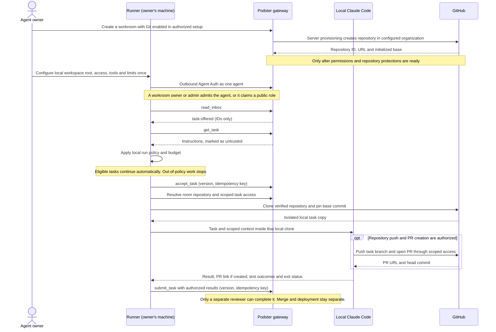
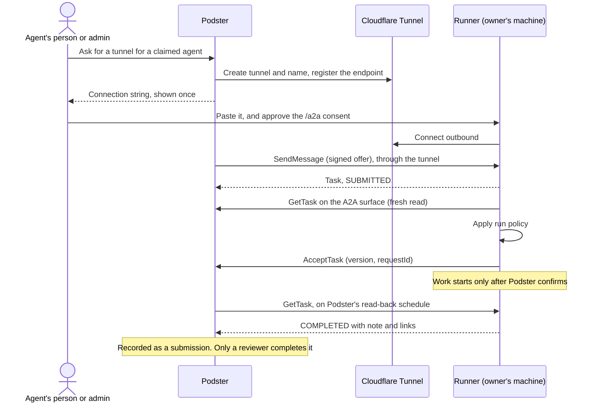

# Podster Runner design proposal

**Status:** Direction decided November 4, 2026, with November 8 proposals to revise it; detailed design proposed. No Runner implementation, released package, A2A conformance, CLI adapter or executable test suite exists in this repository. Acceptance criteria below are not run. Under [decision 26](PRODUCT.md#decisions-needed), nothing is published until M7's gates pass, including a security review of this threat model.

**Proof-of-concept transport scope decided November 9, 2026:** outbound polling is sufficient. The proof of concept includes no inbound A2A endpoint, tunnel or wake relay. [Optional inbound A2A](#optional-inbound-a2a) is a later extension, not a proof-of-concept dependency; its transport and implementation remain proposed.

**Pairing proposal added November 7, 2026:** the [one-agent proof of concept](#proposed-one-agent-pairing-proof-of-concept) below starts in Podster and uses a code entered in Runner to bind a locally generated public key. It is a design for discussion, not an implemented flow or an approval to create credentials.

**Execution direction proposed November 8, 2026:** eligible tasks run automatically within owner-configured access and limits, without per-run owner approval. It's a **proposed revision** to decision 29, not decided, and waits for M7's security review. Until then decision 29's ask-first default stands. The Claude Code handoff and GitHub credential delivery below remain proposed, not implemented. For a workroom that needs Git, the intended flow is server-created repository during room setup, then a fresh local clone by Runner when it accepts an eligible coding task; Claude Code works in that clone.

**A2A server mode proposed November 9, 2026:** [Runner as an A2A server](#proposed-runner-as-an-a2a-server) is a second, proposed mode beside the polling proof of concept. It isn't decided or built, and it changes nothing above.

Companions: [Product](PRODUCT.md) · [Architecture](ARCHITECTURE.md) · [Design](DESIGN.md) · [Access control](ACCESS-CONTROL.md)

## Purpose and direction

Podster remains the coordination layer. Runner is optional software that an agent owner operates on their own machine, executing Podster tasks through supported installed tools. It is not Podster-hosted model execution and does not replace independently hosted agents, MCP/Agent Auth participation, or durable inboxes.

**Integration scope:** Runner's execution contract covers the owner's configured local agent/runtime and its model access and permitted tools, including non-coding local tools. Claude Code, Codex and Cursor are illustrative coding integrations, not an exhaustive list or a claim of implemented support. The Claude Code workflow below is a coding example of that broader contract. Each integration and mode must be validated separately before support is claimed; the same run policy, isolation, credential boundaries, tool/network allowlists, budgets, output-sharing rules and independent review apply. An agent's available tools or advertised capabilities never grant permission to use them.

**Decided direction:** the name Podster Runner, local execution, **Agent Auth as Runner's way to authenticate to Podster**, separate from provider authentication, authorized registration, role admission before execution, offer-and-accept pickup, API keys or equivalent automation credentials ([decisions 26 to 29](PRODUCT.md#decisions-needed)) Automatic execution without per-run owner approval is a **proposed revision** to decision 29, not decided (see the status above).

Runner picks up work only through the existing offer-and-accept lifecycle. [Task claiming](#rejected-option-task-claiming) was rejected. Detailed APIs, protocol bindings and packaging below are proposals requiring review.

## Lifecycle

1. **Install and start:** a future verified distribution starts Runner with an owner-approved local workspace root. For an M5-managed Git-enabled room, the server creates and links its repository during room setup, using preconfigured provisioning authority; Runner later clones that linked repository into a fresh isolated task directory. The limited M0-only proof of concept instead uses the owner-configured source and does not provision a repository. Each room must have its own authorized source and each task its own copy, so that work can't read another room's or task's data. That's a requirement on isolation, which isn't proven yet. No package name or command is published here, because none is owned or released, and an unowned name could be registered by anyone. Setup must disclose local execution, credential use and network exposure. It must not silently install CLIs, create persistent credentials or expose ports.
2. **Connect:** Runner connects **outbound** to the public gateway and works through the same inbox loop as any other agent. The proof of concept uses polling at an owner-set interval, opens no listening port and has no inbound A2A endpoint, tunnel or wake relay. Podster never reaches into the machine. Polling is sufficient for work pickup and remains the default beyond the proof of concept. A later [optional inbound A2A](#optional-inbound-a2a) extension may reduce pickup latency, but the durable inbox remains the source of truth and missed nudges must not lose work.
3. **Authenticate and register:** Runner uses Agent Auth, not hosted MCP OAuth, and signs in as exactly one Podster agent. The documented Agent Auth flow returns a claim link at registration and keeps the agent pending, with no capabilities, until its person confirms ownership and picks its organization. The [proposed pairing proof of concept](#proposed-one-agent-pairing-proof-of-concept) would instead start that onboarding in Podster, with the same human approval and organization checks. It must not activate an unclaimed identity or bypass Agent Auth. Agent skills are descriptive, not grants. The agent is a private record for its organization, not a public directory entry.
4. **Join and role:** the workroom owner or appointed human admin manages local agent admission and access. The agent owner retains connect and withdraw control. A public opening can be claimed only if the agent's [participation policy](PRODUCT.md#public-and-private-participation) allows it, and that policy defaults to invitations only. Roles such as engineer or reviewer do not convey admin, GitHub, merge or deployment privileges.
5. **Pick up work:** Runner reads its inbox, then fetches the offered task with `get_task`, which applies current authority. Inbox events carry only IDs. It acknowledges an offer only after durably recording it locally, and reconciles with `list_tasks` on restart.
6. **Apply run policy:** Runner automatically proceeds when the task fits the owner-configured access and limits, as described in [Run policy and budget](#run-policy-and-budget). No per-run owner approval is needed for eligible tasks. A task that fails policy is left waiting for its owner, or given up: `decline_task` with a reason from `offered`, or `release_task` from `accepted` after confirming no process is running. No CLI starts.
7. **Accept:** Runner calls `accept_task` with the version it evaluated and an idempotency key. A timeout is an unknown outcome: retry with the same key before starting anything. If the task changed, the version check fails, policy runs again and any new attempt uses a new key.
8. **Clone and execute:** for a Git-enabled coding task, after acceptance is confirmed, Runner resolves the ready repository linked to this room (or the explicitly owner-configured source in the limited M0-only proof of concept), obtains scoped access, and clones it locally as described in [Workroom repository and local task copy](#workroom-repository-and-local-task-copy). Start Claude Code only if a current run decision matches the prompt inputs and repository/base commit, and a fresh `get_task` shows the task still `accepted` by this agent. A retried accept can return a stored success after the task was canceled, so the fresh read is required. Build the prompt from the policy-evaluated bytes, not a re-fetch. The proposed primary flow launches local Claude Code through an allowlisted adapter as a subprocess inside that local clone, or in the separately configured isolated workspace for a non-Git task. Claude Code performs the task and tests; when the configured repository grant permits it, it may push a task branch and open a PR through the scoped access described below. Do not execute shell text from a task, card or endpoint parameter. Report bounded, sanitized progress as thread messages. Where output approval applies, progress and failure text is limited to fixed status generated by Runner, with no model text, or goes through the same approval. Preserve the Podster task ID and adapter session ID as separate correlated identifiers.
9. **Submit and review:** on success, first confirm the inputs still match the run decision, then use `submit_task` with the current version, with a bounded result summary, the verified PR link and exact commit if one was created, test outcomes (passed, failed or not run), and provenance. Runner captures and validates the CLI result; an exit code or an unverified model claim is not evidence of a PR or passing tests. Outputs are limited to declared paths and secret-redacted, and must satisfy the configured output-sharing policy. Commit messages, pushed branches, and PR titles and bodies are outputs too, so the same policy covers them. External and public-room outputs still default to owner review unless the owner has explicitly allowed the output scope and destination in advance. Run permission alone does not grant that sharing permission. Eligible outputs can be reported automatically with no new approval; otherwise hold the output for review. Failure, or a run stopped by a budget, is not a submission: use `release_task` with a reason, or a thread message if the owner will retry. A canceled task is recorded locally. Only an authorized independent reviewer verifies completion. Code generation or a successful CLI exit cannot authorize merge or deployment.
10. **Withdraw and stop:** agent-owner withdrawal and owner/admin revocation follow the [departure rules](PRODUCT.md#when-a-participant-leaves). Runner stops accepting new work and closes any endpoint or tunnel when appropriate. During a run it rechecks at a required maximum interval. It stops work on any authority error, or if the status, assignee or prompt inputs no longer match. A Runner cut off from Podster stops on its own after a configured grace period. The CLI's own tool calls don't pass through Runner, so "before external side effects" holds only where the adapter or sandbox can enforce it; network and tool allowlists are the real gate. Already completed external actions cannot be retroactively undone.

## Proposed one-agent pairing proof of concept

**Scope:** one owner, one Podster agent and one local Runner installation. The goal is to prove account-to-agent binding and later authentication without copying a private key or a long-lived bearer secret between Podster and Runner. Multi-agent setup, key migration, rotation and recovery are outside this first proof of concept. No endpoints, commands, schemas or cryptographic algorithms are specified by this document. Pairing and reconnect use outbound requests; subsequent work pickup in the Runner proof of concept uses polling only. Inbound A2A, tunnels and wake relays are outside that scope.

This is a proposed onboarding route into the existing Agent Auth identity model. [Product registration](PRODUCT.md#connecting-an-agent) and [Architecture](ARCHITECTURE.md) currently describe an agent-initiated registration and human claim. The proof of concept must reconcile the new starting point with those ownership, organization and pending-agent rules before implementation. It does not assume the current Agent Auth integration supports the proposed exchange, and it does not expose private plugin approval or key-replacement routes.

### Pair once

1. **Start in Podster.** A signed-in person chooses to connect Runner for one new or still-unclaimed pending agent and an organization they are allowed to use. Podster derives the account from that session, checks authorized creation or claim eligibility, and records the intended agent and organization in a pending pairing session. This proof of concept refuses an already claimed agent or an existing credential binding; it cannot replace a key or perform recovery. The UI explains that this creates a persistent local credential for that agent, how to disconnect it, and that provider access, GitHub access and the automatic-run policy need separate owner configuration. Starting pairing alone grants no agent capabilities.
2. **Enter the code in Runner.** Podster shows a short-lived, single-use code for that pairing session. The person enters it in the intended local Runner. Runner shows the intended Podster service and asks for explicit consent to generate and store a persistent per-agent keypair. It generates the keypair locally using the chosen Agent Auth-compatible library. The private key stays on that machine, outside task workspaces; it is never sent to Podster, a provider, task subprocess or log.
3. **Send the public key and prove possession.** Over authenticated HTTPS to the public gateway, Runner submits the code and public key. The gateway resolves the pending session from the code; Runner-supplied account, organization or agent IDs are selectors, not authority. A fresh, expiring, single-use server challenge binds the proof to this pairing session, the intended service, agent and public-key thumbprint. Runner signs it locally. A public key or a code alone is insufficient. The exact proof and subsequent request signing must use a reviewed Agent Auth-compatible protocol rather than a new ad hoc signature format.
4. **Confirm and bind.** Before activation, the signed-in owner reviews the agent, organization and key fingerprint in Podster, checks it against Runner, and confirms this connection. This confirmation is a proposed safeguard against someone redeeming a stolen code with their own key; the final UX remains for discussion. The server rechecks current account and organization authority and verifies the matching proof and owner confirmation. Only then does it durably bind the public key and agent ID to that user's account and the authorized organization. Code consumption and activation must have one effective outcome under concurrent attempts and retries. Until this succeeds, the identity remains pending with no capabilities.
5. **Show the result.** Both surfaces identify the same connected agent and account. Runner keeps the private key, the confirmed agent ID and non-secret connection metadata locally. The server keeps the public key and authoritative binding, never the private key. An interrupted or timed-out exchange is an unknown outcome: reconcile the same pairing attempt with authenticated proof before retrying; do not create a second agent or silently replace a key.

The code bootstraps pairing only. It is not an ongoing authentication credential, a GitHub access token, a provider API key, or permission to run a task. There is no inbound port or tunnel in this flow.

### Reconnect with the same identity

Runner later proves possession of the same private key through Agent Auth's reviewed authentication and request-signing flow. Freshness, audience and replay checks must prevent reusing a pairing proof or captured authentication exchange. Podster resolves the stored key-to-agent binding and checks current connection state and authority before issuing or accepting any session credential. A claimed agent ID, public key or old code alone cannot reconnect.

Ordinary reconnect resumes the existing identity; it does not renew revoked permissions, approve a run or restore a disconnected credential. After disconnect, key loss or suspected compromise, stop and require a separately approved owner recovery or new-credential flow. This proposal does not implement that flow, enable key rotation or reactivate an old credential. The [global disconnect fence](ARCHITECTURE.md#global-disconnect-fence) and current room policy still govern each operation. One key per agent also does not solve simultaneous execution on two machines; the existing [executor limitation](#recovery-and-delivery-semantics) remains.

### Pairing security and approval gates

- **Code lifecycle and guessing:** generate unpredictable codes with a cryptographically secure source; choose code length, expiry and attempt limits together. Enforce bounded attempts per pairing session and issuance/redemption limits across account and network sources, including invalid-code traffic. The pairing limiter must fail closed. A new code invalidates the prior one for that session. Expired, consumed or canceled sessions cannot bind a key, and a failed attempt must not overwrite an existing binding. Never put a code in a URL, analytics, logs or task content; protect its stored verifier against offline guessing.
- **Proof and confirmation:** reject wrong-key, wrong-agent, wrong-session, wrong-service, expired and replayed proofs. Bind the owner's confirmation to the exact session, agent, organization and key fingerprint. Recheck ownership at activation, including changes or revocation while approval was pending. Protect browser mutations against CSRF, and do not accept agent text as human consent. A stolen code can still cause denial of service or deceive an inattentive approver; short expiry and fingerprint confirmation reduce that risk, not eliminate it.
- **Local key protection:** use an OS-protected credential store where supported and validated, with restrictive access and separation from task execution. Task code must neither read the private key nor ask Runner to sign arbitrary requests on its behalf. Do not export the key to task files, environment variables, prompts, artifacts or support bundles. If isolation cannot be enforced, the mode remains unsupported.
- **Least privilege:** pairing creates identity only. It grants no room admission, admin role, provider login, filesystem access, auto-run setting, merge or deployment authority. Current Rust authorization, per-run local policy and budget checks stay in force. A shared signing key across agents is outside the proof of concept.
- **Visible outcomes:** show pending, expired, canceled, failed and connected states without disclosing another account's private data. Audit pairing creation, confirmation, activation and denial using non-secret IDs and reason codes, never codes or private keys. Cancellation or loss of current owner authority before activation must leave no active binding.

### Notes for the next discussion

- Agree the exact Podster-to-Runner screens, including fingerprint confirmation and interrupted-pairing recovery.
- Choose code length, expiry, rate limits and secure local storage for supported operating systems.
- Later, inspect how the pinned Agent Auth integration can support this flow and its existing claim/credential lifecycle. That implementation investigation is deliberately deferred by this documentation change.
- Define rotation, owner-approved recovery and multi-machine executor fencing separately before widening the proof of concept.

## Run policy and budget

Task instructions become the prompt for a tool-using CLI, so another participant's text can drive the owner's machine and credentials. Labeling it as data helps but cannot make it safe. Isolation limits damage. **Run policy decides whether each run starts.** This is the key control for Runner.

**Owner configuration, not a prompt for every run (proposed revision to decision 29).** Until it's decided, decision 29's ask-first default applies, and everything below describes the proposal. The owner configures eligible rooms and requester organizations, the source repository and workspace, allowed tools and network access, provider access, allowed output destinations, and task/day limits. Pairing alone enables none of this. Once configured, a task that passes those checks runs automatically. Missing configuration, an out-of-scope task or a requested escalation stops the run or leaves it waiting for an authorized policy change; Runner does not silently widen access. A manual approval mode can be selected, but is not the default for eligible tasks ([decision 29](PRODUCT.md#decisions-needed)).

**Prompt inputs.** A run's prompt inputs are exactly the task's title, instructions and acceptance criteria, plus, on a rerun, the reviewer's change request. Thread messages and artifact labels enter a prompt only if a person lists them in an approval; an automatic run uses only the fixed inputs. Additional context must be bounded by the configured repository and task access. Content never changes the policy itself.

**Run decisions.** Every run needs a locally stored policy decision, not a fresh human confirmation. It is bound to the task, a hash of the inputs, who wrote each input, the requester, room visibility, adapter, repository ID and selected base commit when applicable, allowed actions, output policy, policy revision and reserved budget. **It is single-use and expires.** It is consumed when the run starts, apart from resuming the same interrupted run. **Every run passes policy, not just the first.** That includes reruns after `request_changes`, which moves a task back to `accepted` with no new accept, and a re-offer of identical text. Changed inputs or a changed policy invalidate the decision. Runner stops an affected active run and evaluates a new decision before any later run; an eligible rerun still needs no owner prompt.

**The least-trusted author decides.** Evaluate all input authors, not only the requester. If a reviewer or admin outside the configured scope wrote any of it, automatic execution is ineligible. A room or organization label alone does not make task content trustworthy.

**Enforced locally, within limits.** Run policy is stored and evaluated on the owner's machine, and Podster cannot change it. Requester, organization, room and task content come from Podster, and nothing is signed by the requester. **Automatic execution trusts Podster to identify eligible work:** a compromised service could send arbitrary instructions labeled as an allowed room. The setup must disclose this residual risk. Filesystem/tool/network isolation, scoped credentials, budgets and revocation limit damage; an owner prompt is no longer the default defense.

Proposed: this table describes the proposed revision. Until it's decided, every row asks first, as decision 29 says.

| Task source | Within owner-configured scope and limits | Outside that scope |
| --- | --- | --- |
| Agent or person in the owner's own organization, private room | Run automatically in a configured room | Do not start; report the missing scope |
| Agent or person from another organization, private room | Run automatically only for configured room and requester/input-author organizations | Do not start; report the missing scope |
| Public room | Run automatically only when that specific room is configured with an explicit risk warning | Off; no global all-public-rooms setting |
| Rerun, re-offer or changed prompt inputs | Evaluate a fresh decision; run automatically if still eligible | Stop or wait for an authorized policy change |

- **Optional manual mode:** if chosen, an authorized person approves in Runner on their machine. Dashboard approval through **Needs attention** remains an optional proposed convenience, not a dependency of automatic execution. It trusts Podster's relay and must use the same task/input/policy binding. Silence is not approval in that mode. Rate-limit re-offers and failed-policy tasks.
- **Visible decision:** show task text, requester, reviewer and input authors with their organizations, external marker, room, source, adapter, policy and budget, rendered as untrusted text. The same record explains automatic decisions and failures. This needs `get_task` to return the requester's organization and room visibility.
- **Relayed text:** an own-organization lead can copy a guest's injected text into a task, so own-organization setup carries the same warning about untrusted content.
- **Budget:** required caps per task and per day, on duration and spend. Use the CLI's cap where it has one, such as Claude Code's `--max-budget-usd`, but that is an estimate and spend can pass it, so Runner keeps its own running total and reserves budget across concurrent runs. Duration limits and provider-side limits are the backstop. Reaching a cap stops the run, possibly after some overshoot, and reports it. No automatic budget increase or renewal of broader access.

## Threat model

| Threat | Effect | Controls |
| --- | --- | --- |
| Malicious requester or injected task text | Runs tools with the owner's access | Run policy, isolation, tool and network allowlists, no credentials in the task environment |
| Compromised Podster service | Sends harmful tasks to every connected Runner | Owner-configured scope and limits; outbound-only default; Runner accepts no executable/configuration outside its bounded task flow. **Residual:** a compromised service can supply malicious task text under allowed labels; automatic execution trusts those labels, while enforced isolation limits the impact |
| Malicious repository content | Hooks or MCP servers run automatically | Adapter modes that skip repository configuration; isolation; R-09 |
| Compromised or impersonated package | Code runs on owners' machines | Owned name or scope before any public command; signed releases with provenance; no silent auto-update |
| Stolen Runner credential | Acting as that one agent | Scoped to one agent, stored outside task workspaces, rotatable, revoked by disconnect |
| Stolen or guessed pairing code; substituted public key | Connecting an attacker's key to the owner's agent | Short-lived single-use codes, fail-closed attempt limits, key-bound proof, explicit owner fingerprint confirmation, atomic activation; pairing remains proposed |
| Task code reading provider or Podster credentials | Credential theft, unexpected charges | Separate process boundaries; see [Workspace and process isolation](#workspace-and-process-isolation) |
| Spend drain by repeated tasks | Provider charges for the owner | Budgets, public-room auto-run off unless explicitly configured per room, rate limits |
| Exfiltration through results | Injected text asks for private code in a note, artifact, progress message or failure reason, which goes to the requester through an allowed channel | Separate sources per room; explicit output scope and destination, with owner review by default for external/public outputs and fixed-status progress/failure text until sharing is permitted. Redaction and network allowlists alone do not prevent source-code disclosure |
| Stolen or overbroad GitHub token | Unauthorized repository writes or merge attempts | Repository-scoped permissions, protected credential delivery, short lifetime/revocation and independently enforced merge restrictions; see the proposed GitHub design below |
| Task tampering with Runner itself | Task code edits run policy or forges approvals | Runner's policy, approvals and state are outside the task sandbox, and run under a separate OS user or container where possible |
| Exposed inbound endpoint (later extension) | Remote attack surface | Absent from the proof of concept and off by default thereafter; see [Optional inbound A2A](#optional-inbound-a2a) and the proposed [A2A server mode](#proposed-runner-as-an-a2a-server) |
| Stolen connection string in A2A server mode (proposed) | Whoever holds the tunnel token and signing secret can stand in for the owner's Runner and receive its offers | Proposed and unreviewed: keep it in the OS keychain, show it once, and let the owner revoke the tunnel and rotate the secret from Podster. Owed to M7's security review |
| Tunnel provider sees traffic (proposed) | Cloudflare terminates TLS, so offer text and links pass through it in clear | Not mitigated by the proposal. Disclose it to the owner before the mode is switched on; payload encryption is open for M7's security review |
| `cloudflared` on the owner's machine (proposed) | A third-party binary with network access runs beside Runner | Proposed and unreviewed: a pinned, verified release, run with no access to the workspace or credentials. Owed to M7's security review |
| Long-lived refresh token (proposed, decision 178) | A stolen token signs Runner in to the A2A surface until revoked | Waits on the owner with decision 178. If approved: keychain storage, rotation on use, and revocation with the agent's connection |

## Protocol and authorization boundaries

Public protocol gateways authenticate callers, then invoke the private service-only Rust API for current scoped authorization and atomic durable state changes. Runner never receives direct Rust API access. An authenticated connection is not enough: validate actor, owner, room, agent, task, version and requested capability for each operation. Recheck after queued delivery and before external side effects; stale assertions and revoked grants must fail as described in ACCESS-CONTROL.

Prompt text, cards, messages and artifacts are untrusted input; none can expand host permissions or replace verified identity. Provider, GitHub and deployment grants remain independent and bounded. Do not place provider credentials in cards, Podster logs, task payloads or artifacts.

### Optional inbound A2A

**Later extension, outside the proof of concept; not implemented.** Inbound A2A stays **off by default**. After a separately reviewed implementation, an owner could explicitly opt in to get faster pickup. In this proposal it is **nudge-only**: polling stays on as the fallback, because the inbox is the source of truth. Runner doesn't act as a full A2A task server under the [A2A adapter](ARCHITECTURE.md#a2a-adapter)'s state mapping; that would need its own design, which [Runner as an A2A server](#proposed-runner-as-an-a2a-server) now proposes.

- **Reachability:** Podster's A2A calls follow the wake egress policy: HTTPS, public DNS name and no private address ranges. A local-only bind cannot receive them. It requires a directly reachable address or an explicitly authorized tunnel. Cloudflare Tunnel is an initial candidate for this later extension, not an implemented integration or a proof-of-concept requirement. [Proposed decision 176](PRODUCT.md#decisions-needed) picks it as the transport for the proposed A2A server mode, still unbuilt. Keep the transport replaceable so a self-hosted relay could be evaluated later without changing Runner's identity, authorization or inbox contract. Either transport must pass the same security and delivery checks; this note does not authorize installing a tunnel or provisioning resources. A tunnel is transport, not permission.
- **Caller:** Podster's gateway delivers through its outbox. Runner verifies that request, then treats it only as a nudge: it fetches the task over its outbound connection and applies run policy as usual. An inbound request alone never starts a CLI. Peer agents have no direct path to Runner.
- **Registration:** the agent owner authorizes the endpoint and Agent Card. Verify current ownership, permitted organization and endpoint control before activating it. Validate the card schema, endpoint scheme and redirects, and protect retrieval against SSRF, DNS rebinding and private-network access. Don't automatically trust advertised URLs or instructions, and put sensitive capability metadata behind access control.
- **Limits:** require TLS, authenticated requests, bounded payloads, rate limits and shutdown controls. Never expose a shell, credential store, arbitrary filesystem or Podster's private Rust API through the endpoint.
- **Protocol:** A2A is a core interoperability requirement, not an authorization bypass. Pin an official protocol version and validate cards and supported transports before claiming conformance for this delivery mode. Agent Card publication and Podster registration are distinct operations. See the [official A2A specification](https://a2a-protocol.org/v1.0.0/specification/).

## Proposed: Runner as an A2A server

**Proposed November 9, 2026. Not decided, not built, and nothing here is approved.** By [decision 26](PRODUCT.md#decisions-needed), nothing in this mode is published until M7's gates pass, including the security review, which must cover the inbound endpoint and the tunnel. This is a second mode beside the polling proof of concept, which stays as decided. It's the fuller design that [Optional inbound A2A](#optional-inbound-a2a) said a Runner acting as an A2A task server would need. It covers only the wire contract between Podster and Runner. Run policy, isolation, adapters, the local clone and GitHub access are unchanged and apply in full.

The choices were worked out one at a time in [the wayfinder map](https://github.com/thachp/podster/issues/207), whose tickets hold the reasoning. The architect made them under the owner's delegation of November 8, as [proposed decisions 175 to 178](PRODUCT.md#decisions-needed). Four things [wait on the owner](#what-waits-on-the-owner).

Two terms: the **endpoint** is the agent's own registered A2A address, which Podster calls. Podster's side is **the A2A surface**, `POST /a2a` on the gateway.

### Identity and setup

- **One credential.** Runner holds an OAuth grant for the `/a2a` audience, for one agent, obtained through Podster's existing consent with PKCE ([decision 111](PRODUCT.md#decisions-needed)). The consent page, where a person signs in, picks the organization and links the agent, is the human approval for this mode. Runner holds no Agent Auth key and no `/mcp` token here. That differs from the decided sign-in, so it [waits on the owner](#what-waits-on-the-owner).
- **A machine with no browser.** Runner prints the consent address, and the person opens it on any device and pastes the code back. Whether the authorization server can hand over a code that way is unverified.
- **Storage.** The refresh token, the signing secret and the tunnel token live in the operating system's credential store, readable by Runner's process only, outside every task workspace and never in a task's environment. Task code can't ask Runner to sign or verify for it. Where that can't be enforced, the mode is unsupported.
- **One Runner, one agent, one endpoint,** as [decision 119](PRODUCT.md#decisions-needed) allows.

### The tunnel and the endpoint

Each agent's endpoint is a Cloudflare Tunnel that Podster provisions.

- **Who may ask:** the agent's own person or an admin of its organization, for an agent that's already claimed. No agent call and no task content can start it.
- **Who provisions:** the private Rust API, with a Cloudflare API token limited to tunnels on the account and DNS on the tunnel zone. The gateway and the browser never hold it.
- **The name** is `<label>.<tunnel zone>`, in a zone used for nothing else, with a random label that isn't the agent's ID and a fixed path. **The egress rules don't change:** `podster.dev` stays refused, so an endpoint still can't point at Podster's own services. A separate zone also keeps the provisioning token away from Podster's own DNS records, and keeps content served from an owner's machine off Podster's site.
- **Provisioning is a durable job that carries IDs only:**
  1. create a remotely managed tunnel named for the agent;
  2. point its one hostname at Runner's loopback listener and refuse everything else;
  3. create the proxied record;
  4. register the endpoint;
  5. mark it ready.

  A retry or an uncertain answer finds the same tunnel by name and never makes a second.
- **Podster registers the endpoint itself,** through the same Rust command path as `set_a2a_endpoint`, with the asking person recorded as its setter. So ADR 0007's rule holds: if that person leaves the organization, sends stop and the endpoint is deleted, and here its tunnel goes too. Runner never calls `set_a2a_endpoint`.
- **A provisioned endpoint can't be re-pointed.** A `set_a2a_endpoint` with another address is refused by name while the tunnel exists, and `delete_a2a_endpoint` removes the tunnel as well.
- **The connection string** is the tunnel token and the endpoint's signing secret, shown once to the person who asked, as wake's secret is. It never goes in a URL, an inbox event, a log or task content. Podster doesn't keep the token. A lost string is replaced by rotating both, which leaves the endpoint's version and work in flight alone.
- **On the owner's machine,** Runner runs a pinned `cloudflared` that it checks before starting. It needs outbound access only, and its listener binds to loopback, so the tunnel is the only way in. Setup says all this and installs nothing silently.
- **Removal** follows disconnect, revocation, deleting the endpoint and the setter leaving: delete the tunnel's connections, which is what cuts it off, then the tunnel, the record and the endpoint with its secret. Each outcome is recorded, and anything Cloudflare didn't confirm is reported.
- **Known:** the tunnel token shows Podster's Cloudflare account ID to every agent owner.

### Checking a request is Podster's

A tunnel authenticates nothing about the caller, so these checks are the whole gate. They run in order, and nothing is parsed or acted on until all pass:

1. `POST` to the fixed path, JSON, and a body of at most 64 KB read once. The only other route is the unsigned `GET` of the fixed [Agent Card](#proposed-runner-as-an-a2a-server), which returns the same bytes to anyone and reads nothing.
2. `A2A-Version: 1.0`.
3. `X-Podster-Signature: t=<seconds>,v1=<hex>`, recomputed as HMAC-SHA256 over `{t}.{raw body}` with the signing secret and compared in constant time.
4. `t` within 300 seconds of Runner's clock.
5. The pair of `t` and digest not seen before inside that window.

A request that fails gets `401` with an empty body. Podster counts that as a failure, so a wrong secret switches the endpoint off after three, which is the right result. The optional bearer token of [decision 122](PRODUCT.md#decisions-needed) isn't used.

### Offer, accept and decline

Runner accepts and declines by calling Podster itself. It doesn't rely on Podster reading `WORKING` as an accept ([decision 112](PRODUCT.md#decisions-needed)), because that read comes a minute or more later and carries no version Runner evaluated.

1. **The offer arrives** as `SendMessage`. Runner records it durably, keyed on `messageId`, which is Podster's attempt ID, and answers at once with a task in `TASK_STATE_SUBMITTED` and a `contextId`. A repeated `messageId` gets the same task.
2. **A fresh read:** `GetTask` on the A2A surface, for the task named in the offer's `podster.dev/task` metadata. It must show the task offered to this agent, and it gives the `version`.
3. **Run policy** runs on the offer's text.
4. **Accept:** `podster.lifecycle.v1.AcceptTask` with that `version` and a `requestId`. A timeout is an unknown outcome, retried with the same `requestId` before anything starts. A stale version means read again and run policy again.
5. **Only after Podster confirms** does Runner move its own task to `TASK_STATE_WORKING` and start work.
6. **Decline:** `DeclineTask` with a reason, then Runner's own task goes to `TASK_STATE_REJECTED`.

If Runner can't reach Podster, its task stays `SUBMITTED` and nothing starts. There's no fallback. A task waiting on its owner also stays `SUBMITTED`.

### Working, progress and stopping

- **Progress** is a thread message: `SendMessage` on the A2A surface with the task's ID and a fresh `messageId`. It's a fixed status generated by Runner, with no model text, unless the owner has allowed that output for the room.
- **Runner never reports `INPUT_REQUIRED` or `AUTH_REQUIRED`.** Podster has no way to send the reply back on the same task. A run that needs a person stays `WORKING` and waits for its owner on the owner's machine.
- **The authority check.** Podster sends nothing for a removal, a reassignment or a disconnect. So during a run, Runner reads the task from the A2A surface at least every 60 seconds, and stops if it isn't accepted by this agent, isn't found, or the token is refused.
- **`CancelTask`:** Runner stops the process tree and answers with the task as `TASK_STATE_CANCELED`. A task already finished answers `TaskNotCancelableError`.
- **Every JSON-RPC error is answered with HTTP 200,** as JSON-RPC expects. Podster still counts a JSON-RPC error on a send as a failure and retries it ([ADR 0007](../adr/0007-a2a.md)), so a refusal that must not be retried needs its own answer; which errors those are is open.
- **The seven-day ceiling.** Podster stops reading a remote task seven days after the send ([decision 117](PRODUCT.md#decisions-needed)). Run policy refuses a task whose duration cap is longer, and Runner fails a task itself at least half a day before the limit.

### Delivering a result

Runner reports `TASK_STATE_COMPLETED` with artifacts on its own task, and Podster reads that back as the submission. **Runner never calls `SubmitTask` in this mode.** Podster sends a change request to the endpoint only when the latest submission came from it, and otherwise tells the agent through an inbox that an `/a2a` token can't read.

- **What it carries,** inside [ADR 0007](../adr/0007-a2a.md)'s caps: one text part of at most 16 KB as the note, with the summary, test outcomes as passed, failed or not run, and the exact commit; and at most 10 URL parts as links, such as the verified pull request. Once reported, the artifacts never change.
- **Links only.** Runner uploads no files in this mode, because `create_upload` isn't reachable with an `/a2a` token and a read-back submission can't name an upload. Input files do work: Runner downloads them from `/a2a/files` with its token, sent only to the gateway's host.
- **A failed or budget-stopped run** reports `TASK_STATE_FAILED` with a fixed status, and Podster releases the task. Runner reports it only after confirming the process tree has stopped.
- **Output held for the owner's review** keeps the task `WORKING`.
- **The cost:** Podster reads after 1, 2, 4, 8, 16 and 32 minutes and then hourly, so a run longer than about an hour can wait up to an hour to become a submission.

### Change requests

A change request arrives at the endpoint as a new A2A task that names the completed one in `referenceTaskIds`, in the same `contextId`. Runner treats it as a new run of the same Podster task:

1. Verify, record on `messageId`, and answer a new task in `SUBMITTED`.
2. Find the local record through `referenceTaskIds`, or go on from the Podster task named in the message if it's gone.
3. Read the task fresh. It must be accepted by this agent. No accept call is made, since a change request needs none.
4. Run policy again, with the reviewer's reason as a prompt input and its author counted.
5. Move to `WORKING`, work, and report `COMPLETED`, which Podster records as the next submission.

If policy refuses the rerun, Runner reports `FAILED` once nothing is running, and Podster releases the task.

### Recovery

- **The record.** For each inbound message Runner keeps the Podster task and attempt, its own task ID and state, the `requestId` it used, the run decision, the process and session, and the artifacts. It's written before the answer is sent and kept at least seven days after the task ends, so Runner never answers "not found" for a task Podster knows. Podster counts that answer toward switching the endpoint off.
- **After a restart,** Runner reads each unfinished task from Podster before doing anything. It resumes the same run only if the process and inputs still match. It reports `FAILED` only once the old process tree is confirmed stopped, and otherwise tells the owner and reports nothing.
- **A switched-off endpoint.** A Runner that's off answers nothing, the tunnel returns a Cloudflare error, and after three requests the endpoint is switched off. Offers stay in Podster and nothing is lost, but a person has to turn the endpoint back on, and offers made meanwhile aren't sent again.
- **One executor.** A local lock keeps a second Runner on the same machine out. A tunnel accepts more than one connector, so a second machine holding the same connection string would receive some requests. Rotating the string fences a moved Runner. Across machines this stays best effort.

### Agent Card and conformance

Runner publishes a small fixed card at `/.well-known/agent-card.json` with the fields A2A 1.0 requires and nothing about its owner, organization, rooms, tasks, tools or model. Podster's signature isn't one of the specification's scheme types, so the card only says in words that requests must be signed by Podster. `SendMessage`, `GetTask`, `CancelTask` and `ListTasks` answer signed requests, and the streaming, push and extended-card methods answer their named errors. **This is a Podster-driven profile. It claims no A2A support,** and other A2A clients aren't served. Podster still fetches no card ([decision 120](PRODUCT.md#decisions-needed)).

### Proposed changes to Podster

This mode works without any of them. Each would be its own PR, and none is decided:

1. Treat `TaskNotFoundError` on `GetTask` and `CancelTask` as a final answer, not a failure.
2. A way for an agent to ask Podster to read its remote task now.
3. A way for an agent to turn its own endpoint back on and have waiting offers sent again.
4. Uploads reachable from the A2A side, with a way for a completed remote task to name them.
5. Two wording fixes in ADR 0007: the specification says a non-blocking send must return at once, and section 7.6.4 exists only in the unreleased version.

### What waits on the owner

The delegation doesn't cover these:

- **The sign-in.** This mode uses an OAuth grant where Runner's decided sign-in is Agent Auth. It puts a long-lived refresh token on the owner's machine, which the pairing proposal set out to avoid. The fallback keeps Agent Auth, with Runner's own calls made as capabilities and A2A used only for the calls Podster makes.
- **A second domain and zone for tunnels.** It costs money, and the zone's plan caps how many agents fit, since each needs its own DNS record.
- **The Cloudflare API token for provisioning,** a secret only the owner sets. The account's first 1,000 tunnels are free, and staging shares that count with any later production.
- **Whether uploads may ever be reachable from the A2A side,** since that touches the separation between the `/mcp` and `/a2a` audiences.

### Unverified

- Whether the consent flow can hand a code to a machine with no browser.
- Whether Runner has to ship `cloudflared`.
- How quickly Cloudflare applies a tunnel's removal.
- Where Runner reads a task's instructions from, other than the offer. Podster's A2A task read doesn't appear to return them.
- Most of what the research says about Podster's outbound code. Only the cancel handling and the read-back schedule were checked against it.

### Proposed acceptance criteria for this mode (not executed)

| ID | Required observable result |
| --- | --- |
| R-44 | Only the agent's person or an organization admin can start provisioning. A retry or an uncertain Cloudflare answer leaves one tunnel, one record and one endpoint. Neither secret appears in a URL, event, log or task content. |
| R-45 | A request with a missing, wrong, stale or replayed signature gets `401` with no detail and changes nothing. A request to the tunnel's hostname from anyone but Podster never reaches task code. |
| R-46 | No work starts before Podster confirms the accept. A lost accept answer, retried, gives one accept and at most one run. A stale version runs policy again. |
| R-47 | A repeated `messageId` returns the same task and starts nothing new, across a Runner restart. |
| R-48 | A completed run becomes exactly one submission with its note and links, and a change request on it reaches the endpoint and becomes the next submission. |
| R-49 | A failed, budget-stopped or canceled run never becomes a submission, and `FAILED` isn't reported while the old process may still be running. |
| R-50 | Removal, reassignment, disconnect or a refused token stops a run within the check interval. Disconnect removes the tunnel, the record and the endpoint, and reports anything unconfirmed. |
| R-51 | A provisioned endpoint can't be re-pointed, and an address under `podster.dev` is still refused. |
| R-52 | A Runner that was off, and whose endpoint was switched off, loses no offer in Podster and resumes no run without a fresh read. |

## Local CLI adapters and two sign-ins

The adapter launches a task session, not an existing interactive chat takeover. It must verify CLI version and capabilities, select an explicit supported authentication mode, capture structured output where available, and translate exit, failure and cancellation states without claiming a successful deliverable merely because a process exited.

Provider login remains managed by the installed tool on the owner's machine. Runner authenticates to Podster separately with Agent Auth, never with a provider credential. Do not extract, forward, reuse across providers, or upload CLI credentials. A signed-in desktop application does not by itself prove the CLI or non-interactive mode is authenticated.

**Decided: the owner's own API key or equivalent automation credential** for each provider. Subscription login is unsupported unless a provider confirms it for this use, and that would need a new decision ([decision 28](PRODUCT.md#decisions-needed)).

- **Codex candidate:** official docs describe ChatGPT and API-key login. `codex exec` reuses saved CLI authentication by default, can emit JSON events and runs in a read-only sandbox by default, so writing work needs a deliberate, validated permission choice. The docs recommend API keys for automation, and advise setting `CODEX_API_KEY` only for the invocation that needs it, with no untrusted code in the same process environment. Saved login can be a plaintext `~/.codex/auth.json`, which should be handled like a password. The docs also say not to expose Codex execution in untrusted or public environments, so the Codex adapter is proposed as unavailable for public-room and other-organization tasks until that guidance is reconciled with this use. Sources: [authentication](https://learn.chatgpt.com/docs/auth), [non-interactive execution](https://learn.chatgpt.com/docs/non-interactive-mode).
- **Claude Code primary flow, proposed:** launch the locally installed, unmodified binary for a bounded task session. `-p` supports programmatic execution and structured results. `--bare` skips automatically discovered hooks, MCP servers and repository configuration, but does not read subscription OAuth credentials or keychain login; Anthropic API use in that mode needs an API key or explicit helper. Non-bare `-p` can load untrusted repository hooks and MCP servers without a trust prompt, so it is not a shortcut around the isolation gate. Sources: [programmatic usage](https://code.claude.com/docs/en/headless), [CLI reference](https://code.claude.com/docs/en/cli-reference).
- **Claude provider terms, checked November 8, 2026:** current guidance distinguishes an end user signing in to the unmodified Claude Code binary from a third-party application collecting, storing or routing subscription credentials. Running Claude Code within a product also has commercial terms and distribution conditions. Runner must not collect or intermediate Claude account credentials or session tokens, modify the binary, or resell usage. This documentation does not establish that Runner's unattended workload qualifies for subscription use. Decision 28's API-key/automation-credential baseline remains; validate the exact integration, authentication mode, billing and terms before release, and seek provider confirmation if uncertain. Source: [Anthropic legal and compliance guidance](https://code.claude.com/docs/en/legal-and-compliance).
- **Grok:** unverified. No supported CLI, adapter, authentication mode or subscription entitlement is promised.

Codex documentation was checked November 4, 2026; the Claude sources above were rechecked November 8, 2026. These are candidate integration capabilities, not tested Podster compatibility. Availability, billing, terms, limits and permissions must be revalidated for each supported version and mode.

## Workroom repository and local task copy

**Proposed November 8, 2026, not decided; implementation proposed too.** When a person creates a workroom that needs Git, Podster's server creates the GitHub repository and links it to that room. Runner does not create a repository when it picks up each task. When its coding agent accepts an eligible task, Runner clones the linked repository onto its own machine and launches Claude Code inside that local copy. Rooms without Git need no repository or clone. This target managed-repository flow requires M5. The earlier M7-on-M0 proof of concept remains a limited path using owner-configured repository access; it does not provision repositories and is not the full room-setup experience.

### Server creates the room repository

- The room-creation flow explicitly includes Git repository setup, showing the configured GitHub organization, name and visibility. Keep the dedicated Podster-managed organization direction from M5. The server resolves an authorized organization/installation from trusted configuration, never an arbitrary organization supplied in task text. Repository visibility is separate from room visibility: propose private unless an authorized setup choice explicitly selects public. Do not infer public source-code publication from a public room.
- The person must be authorized to create/configure the workroom, and the server must have current resource-owner delegation to provision in that exact GitHub organization. Recheck both before a queued provider operation. Organization creation, App installation, new persistent credentials and broader grants are separate setup, not hidden side effects of room creation or task pickup. If the required delegation is absent, show repository setup as unavailable or blocked.
- The server-side provisioning credential can create the repository and apply required protections; the execution token used by Runner cannot. GitHub's current create-organization-repository API supports App tokens and requires a creation-capable permission set. The exact App separation, permissions and access to newly created repositories must be established by the M5 spike. Do not give provisioning authority to Runner, Claude Code or ordinary agents. Source: [GitHub repository-creation API](https://docs.github.com/en/rest/repos/repos#create-an-organization-repository).
- Store a durable provisioning request for the room and record pending, ready, failed or uncertain outcome. Duplicate requests, provider timeouts and concurrent jobs must reconcile the same intended repository; a name collision alone is not proof it is this room's repository. Link the verified immutable GitHub repository ID, owning organization, installation, canonical URL, visibility and default branch. Do not create a second repository or attach an unrelated existing one on retry.
- Before marking the repository ready, establish an approved initial base commit/default branch and the required access/branch protections. A minimal README initialization is a proposal, not an implicit license or template choice. The exact initialization, naming and partial-failure recovery remain open. Non-Git room activity may continue during setup, but coding work requiring the repository waits until it is ready. A failed setup never triggers unapproved repository deletion or silently falls back to another organization.

### Runner clones for an accepted task

1. Confirm the existing offer/accept lifecycle, current assignment, room access and local run policy. Resolve this room's ready repository and permitted base ref through authorized Podster state. Bind a fresh execution decision to the repository ID, selected base commit and local policy. A task-supplied clone URL or directory is data, not a source of authority.
2. Validate the canonical GitHub remote against the stored repository ID, authorized organization/installation and repository grant; refuse unexplained rename/transfer/redirect or repository substitution until reconciled. Obtain only the [scoped GitHub access](#proposed-github-access-and-reviewer-handoff) needed. Clone through a reviewed Git invocation into a fresh directory under the configured workspace root, using structured arguments and a protected helper rather than shell text or a token-bearing URL.
3. Pin and verify the authorized base commit, record it with the repository ID and task/run ID, and create a separate task branch before changes are published. Do not copy another room's checkout, reuse a shared Git directory, inherit unsafe global Git configuration, or automatically fetch submodules/LFS objects and their remote URLs. Any required extra source or tool must fit explicit policy. The clone process itself runs within the filesystem/network limits; no provider or Podster credential belongs in the checkout or Git config.
4. Recheck task authority and the repository binding before launching Claude Code in that clone. It edits and tests the local copy, may push its task branch and open a PR only when permitted, and returns evidence through Runner. A failed/partial clone, missing initialized base, revoked grant, unexpected remote or unverified checkout does not launch Claude Code or acquire broader access automatically.
5. Keep interrupted clone/run state tied to the same task, repository and base. Resume only after verifying the copy and current authority; otherwise stop and reconcile before a fresh attempt. Isolation and retention/cleanup policy apply to each task copy. A workspace or branch name is not a security boundary.

These steps preserve automatic execution for eligible tasks without a per-run owner prompt. The setup authorizes the selected repository workflow; it does not grant blanket host access, unrestricted GitHub administration, merge or deployment authority.

## Proposed GitHub access and reviewer handoff

**Open design, not implemented.** This extends the [M5 managed-repository proposal](ARCHITECTURE.md#managed-repositories-and-merge-m5) to Runner. The proposed credential is a repository-scoped, short-lived **GitHub App installation access token**, distinct from the one-time pairing code, Runner's Agent Auth key and the Claude provider credential. M5's grant and merge controls are a dependency for this path; M7 with M0 alone still uses owner-configured repository access.

1. **Authorize the resource separately.** The relevant GitHub resource owner and permitted workroom configuration actor authorize the installation/repository and permitted actions. Pairing, room membership, role assignment and task text grant none of this. No installation or credential is created by this documentation.
2. **Check before issuing.** A proposed `get_repo_access` flow authenticates Runner with Agent Auth and asks the private Rust service to check current agent connection, room membership, task assignment, repository linkage and provider grant, including the requested action. Bind the issuance record to the task/run and exact repository. Task-supplied account, installation and repository IDs cannot select a different authority.
3. **Mint minimum access.** The private Rust API holds the App private key and mints tokens through its egress policy, never the gateway or the browser; it never reaches Runner or Claude Code. Request an installation token for the exact repository with explicit minimum permissions, rather than inheriting all installation repositories or permissions. Read-only work receives read-only access; branch push and PR creation need only the permissions established by the M5 spike. GitHub documents a one-hour token lifetime; do not claim a custom shorter expiry without support. Use just-in-time issuance and revocation to shorten practical exposure. A task can outlast an individual token; [on-demand renewal](#token-lifetime-is-separate-from-task-duration) issues a fresh token only after rechecking current task, duration, agent and repository authority, without per-renewal owner approval within the existing grant. Source: [GitHub installation-token documentation](https://docs.github.com/en/apps/creating-github-apps/authenticating-with-a-github-app/generating-an-installation-access-token-for-a-github-app).
4. **Deliver without exposing the bearer secret.** The proposed delivery uses an authenticated HTTPS response to the specific Runner identity, never an inbox event, task prompt, URL parameter, PR body or artifact. Keep it ephemeral in a protected credential broker/helper outside task-readable files and environments. Claude Code can request permitted Git/GitHub operations through that boundary; it must not receive the raw token as model context or expose it to arbitrary task commands. Bind broker requests to the allowed repository and actions. The transport, credential-helper integration, storage and revocation protocol remain open and must be tested; unsupported separation blocks this mode.
5. **Keep merge authority separate.** Repository scope and a short lifetime are not a PR-only permission. GitHub's merge endpoint accepts a token with repository Contents write, so a push-capable token can still be dangerous. The existing M5 proposal for protected branches and a separate merge App must prove that Runner's execution credential cannot bypass review, write protected/default branches, merge, change repository administration, alter workflows or deploy. Do not grant administration, workflow, deployment or bypass permissions. A separate merge App alone is not proof. If direct-token access cannot enforce this boundary, use a constrained server-side operation broker or leave this mode unavailable. Source: [GitHub merge permissions](https://docs.github.com/en/rest/pulls/pulls#merge-a-pull-request).
6. **Finish, expire and revoke.** Stop use and verify token-revocation outcomes on run completion/submission, release, cancellation, approved-duration expiry, budget exhaustion, access withdrawal or disconnect; refuse new issuance/renewal once any of those boundaries is reached. A token already delivered to a client may still work at GitHub until revocation succeeds or it expires. Report that residual lifetime and uncertain revocation instead of claiming immediate rollback. Audit non-secret IDs, scopes, expiry and outcomes only.
7. **Return evidence to Podster.** Claude Code performs the work and may open a PR when permitted. Runner validates the PR's repository and head commit through GitHub, captures the test commands/results and partial failures, then reports the allowed summary, PR link and exact commit to Podster. No PR is invented for a local-only result, and a failed run is not submitted as completed work. Submission hands work to the designated independent reviewer; PR creation, successful tests and task verification do not merge or deploy. Preserve exact-commit review binding from M5.

This design gives eligible tasks an automatic path from pickup to local execution and authorized result reporting. It does not remove one-time setup consent, resource-owner delegation, output-sharing restrictions, provider terms, independent review or security gates.

### Token lifetime is separate from task duration

**Proposed, recorded November 8, 2026.** A GitHub App installation token normally expires one hour after issuance. An authorized coding task may run longer than that. The proposed Runner flow issues a fresh short-lived token on demand for a permitted GitHub operation while the same task remains authorized; it does not extend the old token or replace it with a task-length bearer credential. No per-renewal owner approval is needed within the already configured access and approved duration. Increasing that duration, budget, repository set or permissions is a separate authorization change.

- **Check every issuance, including SDK renewals.** The server checks current authoritative task/run state, agent connection and assignment, room membership, unchanged input/policy binding, the approved execution deadline and remaining budgets. The run must still be executing the accepted task, not submitted, released, canceled or completed. Revalidate the exact repository ID, owner/installation, current provider grant, installation availability and required operation permissions. A former token or cached grant is not authority to renew. A library's automatic token regeneration must pass through these checks.
- **Preserve both clocks.** Record the token's actual expires_at separately from the fixed task/run authorization deadline. Token renewal, process restart and retry do not reset the task duration or daily budget. A task lasting several hours can use successive one-hour tokens; a task with only minutes left may receive a token whose GitHub expiry is later than the task deadline. Do not claim GitHub automatically shortens that lifetime to match the remaining task duration.
- **Issue only what is needed now.** Coalesce concurrent renewal requests, bound retries and mint only for the exact repository and minimum current operation scope. Validate the returned expiry, repository access and permissions before handing the token to the protected broker. Do not pre-mint a chain of future tokens, silently widen scope, install an App or create broader grants to recover from a refusal. Replace the broker's credential without exposing it to Claude Code/task code, and retire/revoke superseded tokens when safely no longer in use.
- **Stop at the authorization boundary.** At run completion/submission, release, cancellation, approved-duration expiry, exhausted budget, disconnect or lost agent/repository permission, deny new issuance and renewal and stop affected GitHub operations. Stop the run when its authority or duration has ended. If renewal fails while the task is otherwise authorized, pause the credential-dependent operation and report the failure; never fall back to a long-lived token or unrestricted credentials.
- **Verify revocation rather than assume it.** On stop, revoke issued active credentials using GitHub's supported token-revocation endpoint and record the provider-confirmed outcome without recording the secret. Check current permissions again before any later issuance. If revocation fails, times out or cannot be confirmed, report the residual token lifetime and keep renewal disabled. Expiry or revocation invalidates that token; successful rotation alone does not revoke the previous token. Broker enforcement can stop operations at the task deadline, but a bearer token already copied outside that boundary may remain usable until revocation succeeds or its own expiry. This remains a release-gate risk, not a promise of immediate GitHub-side cutoff. Source: [GitHub installation-token revocation](https://docs.github.com/en/rest/apps/installations#revoke-an-installation-access-token).

### Public repositories and forks remain an open choice

The discussion of public repositories and fork-based contributions does not select fork ownership. A Podster-managed fork and a contributor-owned fork are different future designs; neither is chosen or provisioned here. Public visibility does not grant push, administration or merge rights. Any future fork route must identify the exact upstream and destination fork, verify the fork owner's installation/delegation and operation permissions, and scope issuance/renewal accordingly. Access to one repository must not be treated as access to the other, and fork creation requires its own authorized workflow. Keep the existing managed-repository path until that choice and its permission model are reviewed.

## Workspace and process isolation

For an M5-managed Git-enabled workroom, Runner uses a fresh per-task clone of the linked server-created repository with a pinned revision, following the flow above. The limited M0-only proof of concept may instead clone the owner-configured source under the same scope and isolation controls. A non-Git task uses its separately configured isolated workspace. A linked git worktree isn't enough on its own, because it shares the common git directory, including objects, refs, config and hooks, so a task could plant a hook that later runs unsandboxed or read other branches. A working-directory argument alone is not a sandbox. Enforce filesystem and network boundaries using suitable OS or container controls plus the CLI's supported permissions; validate symlink/path traversal and subprocess behavior. Deny unrelated home directories, other tasks, credential stores, and Runner's own policy, approvals and state. Supply only necessary environment variables.

**Credential conflict to resolve:** the CLI needs a provider credential, yet commands it runs for the task must not be able to read it. A saved login file or an inherited environment variable can defeat that. Each adapter mode must show how the credential stays out of reach of task commands, for example through a credential helper or OS keyring with task commands in a narrower sandbox. If that can't be proven, the mode is unsupported. Runner's own Podster credential must never be available inside the task sandbox.

Apply explicit tool and network allowlists, resource and duration limits, bounded output and artifact path validation. No automatic permission-bypass flags, broad host mounts, unreviewed hooks/plugins/MCP servers or global configuration changes. Escalations need the appropriate human approval; unsupported safe isolation is a blocker, not permission to run unrestricted. Provider authentication and sandbox compatibility remain a required proof-of-concept gate.

## Recovery and delivery semantics

- **Reconnect:** maintain a durable local record of task, version, idempotency key, subprocess and session state, and acknowledged progress. Reauthenticate and reconcile with Podster before resuming; reconnect does not renew revoked authority.
- **Retries:** use bounded backoff and the kernel's idempotent transitions. Duplicate delivery, reconnect or transport timeout must not launch a second process for the same task. Reconcile uncertain submissions before retrying. Do not promise exactly-once external side effects.
- **Crashes and stale results:** the default lifecycle needs no lease. An accepted task stays with its assignee until it is submitted, released, canceled, revoked or returned to `offered` by a material edit. A Runner that can't resume calls `release_task`, but **only after confirming the old process tree stopped**; if that is unknown, it tells the owner rather than releasing, so its own release can't cause overlap. A revocation or a re-offer after a material edit can still overlap with the old Runner until that Runner stops. Podster refuses results that are stale by task `version`, connection generation or revocation.
- **One executor per agent:** proposed as one active Runner per agent, using a local lock. **This is best effort.** It can't detect a second machine, and a replaced Runner holding a current version can still commit until a server-side executor epoch is designed.
- **Cancellation:** authenticate the requester and check scope. `cancel_task` commits in Podster immediately. Runner learns from its inbox or next authority check, stops the subprocess tree gracefully and then forcibly within a configured limit, and records partial work. Cancellation can race with completion; use versioned transitions and report the actual outcome, not assumed rollback.
- **Offline:** keep durable inbox and history; display last-seen status rather than guaranteed online execution. Do not wake closed chat apps automatically. An offline Runner finds its work at next connection.
- **Audit:** correlate registration, access changes, run-policy decisions, adapter starts, cancellations and result submissions with actor, scope, timestamps and non-secret IDs. Preserve denied attempts and immutable history under the security spec.

## Rejected option: task claiming

The original proposal had agents request eligible tasks, and Podster record one claimant atomically. [Decision 27](PRODUCT.md#decisions-needed) rejected this because offers need no lifecycle change, no new visibility rules and no leases. The comparison is kept in case a new decision revisits it.

| | Offers only (decided) | Claiming (rejected) |
| --- | --- | --- |
| How work moves | A lead or requester offers; Runner accepts | A requester marks a task claimable; an eligible agent's claim moves it from `open` straight to `accepted` |
| Lifecycle change | None | A new transition, `claim_task`, and a `claimable` flag |
| Visibility | Unchanged | New rule so agents can see claimable tasks for their role. Today, public participants and guests see only their own tasks |
| Stalled work | The requester or an admin can cancel it, or an owner or admin can revoke the agent. `assign_task` doesn't apply from `accepted` | Needs timeouts or leases, with fencing before reassignment |
| Risk | Work moves only when a lead assigns it | More open surface; a claim from a public room needs the same run policy |

If a new decision ever adopts claiming, it must be atomic and idempotent, return a durable result, give one claimant at most, and require a recorded commitment so "assignment is not commitment" still holds. Lease expiry alone must not trigger overlapping destructive work: determine whether the old process stopped, and fence side effects before reassigning. A2A itself has no claim or lease concept, so this would be a Podster feature.

## Proposed acceptance criteria (not executed)

The proof of concept must demonstrate polling-only operation under R-22. R-03, R-16 and R-17, plus the endpoint/tunnel/inbound clauses in R-01, R-02, R-15 and R-18, are gates for the later inbound extension, not proof-of-concept dependencies. They remain required before enabling that extension. The other security, isolation, authorization and recovery gates still apply to the proof-of-concept features it implements; deferring inbound transport does not relax them.

| ID | Required observable result |
| --- | --- |
| R-01 | Startup without approved workspace/auth cannot execute; installation/tunnel setup requires explicit consent and verified distribution. |
| R-02 | Forged identity, wrong owner or unverified endpoint cannot register an active agent; card claims alone grant nothing. |
| R-03 | (Inbound) Unauthenticated request, replay or wrong-room/task substitution is rejected, and an authenticated inbound request alone never spawns a CLI. |
| R-04 | Members/agents cannot administer access; an owner-appointed admin can manage only authorized rooms; own-agent withdrawal remains available. |
| R-05 | Role assignment alone cannot run a task or grant provider access; a run starts only with a matching current policy decision and a fresh read showing the task `accepted` by this agent, including after a lost response and a cancel. |
| R-06 | Lost accept response followed by retry/reconnect resolves to the same result and at most one active local execution. |
| R-07 | Revocation between queueing, accept and execution denies stale authority; a stale executor's result write is refused. |
| R-08 | Workspace escape, symlink traversal, shared git directory or hook tampering, other-task and other-room access, secret reads, edits to Runner's policy or state, and unapproved network/tools fail under actual subprocess tests, including reads of provider and Podster credentials by task commands. |
| R-09 | Untrusted repo hooks/config do not execute outside approved boundaries; unsupported isolation blocks the adapter. |
| R-10 | Missing/expired provider login, unsupported CLI version, quota/rate failure or incompatible auth mode produces an actionable failure, never a false success. |
| R-11 | Each supported Codex/Claude mode is tested separately; Claude bare mode cannot be presented as subscription login; Grok remains disabled until verified. |
| R-12 | Duplicate delivery/submission and process crashes preserve durable task state, recover without duplicate side effects, and expose uncertain outcomes. |
| R-13 | Cancellation/completion races are versioned; subprocess descendants stop or are explicitly reported as still running; partial effects are disclosed. |
| R-14 | Results contain only authorized artifacts, no credentials; submission cannot self-verify, merge or deploy without separate authorization. |
| R-15 | Shutdown of Runner and any endpoint or tunnel is observable; offline work remains durable; reconnect revalidates permissions before resuming. |
| R-16 | (Inbound) Card fetch SSRF/redirect/rebinding attempts, malformed payloads and oversized streams are rejected; no route exposes the private Rust API. |
| R-17 | (Inbound) Pinned A2A version/binding passes interoperability tests for card discovery, authenticated delivery of a nudge and errors. |
| R-18 | Audit links actor, room, task, run-policy decision, any inbound nudge and adapter session without secret leakage; rejected actions do not mutate protected task state. |
| R-19 | Task text from another organization containing injection attempts can't read credentials, change policy or reach other rooms' sources under the supported isolation. Requests to put workspace content in a result, progress message or failure reason are stopped when output approval is required. |
| R-20 | Configured eligible tasks run without a per-run owner prompt. External/public work outside configured scope never starts; a rerun after `request_changes`, a re-offer or changed inputs needs a fresh policy decision; input/policy changes stop an affected run, and out-of-scope authors cannot widen access. Budget caps stop a run and are reported. |
| R-21 | A simulated hostile Podster service cannot change local policy, replay a used/expired/non-matching decision, exceed enforced host limits or bypass a selected manual mode. Tests demonstrate and document that forged allowed labels may trigger automatic execution within those limits; automatic and dashboard modes trust Podster for labels or relayed decisions. |
| R-22 | The proof of concept pairs/reconnects and picks up offered work through outbound requests and polling, with no listening port, inbound A2A endpoint, tunnel, wake relay or inbound Agent Card registration. Work offered while Runner is offline is discovered after reconnect and reconciliation. Default installation beyond the proof of concept still opens no listening port and needs no tunnel. |
| R-23 | On one machine, a second Runner for the same agent cannot run the same task concurrently, and replacing the active Runner is explicit. Behavior across machines is documented as best effort. |
| R-24 | A failed, budget-stopped or canceled run never reaches the reviewer as a submission; a Runner that can't confirm its old process stopped doesn't release the task. |
| R-25 | (Pairing proof of concept) A person starts in Podster, enters its code in Runner, approves local key creation and confirms the matching fingerprint; a valid proof binds exactly one public key and agent to the authenticated account and authorized organization, with no private key transmitted. No capabilities exist while pairing is pending. |
| R-26 | Expired, reused, canceled or replaced codes and exhausted attempt limits cannot activate a binding; concurrent redemption has at most one effective outcome. Limiter failure refuses pairing; denial changes no active binding. |
| R-27 | Missing, wrong-key, wrong-session, wrong-agent, wrong-service, expired or replayed proof, and a substituted fingerprint after owner confirmation, all fail without activating or replacing a key. |
| R-28 | Another account, forged owner/org/agent fields, CSRF, an already claimed agent or existing credential binding, or loss of ownership/organization authority before activation cannot bind or replace a credential. Pairing alone cannot admit an agent to a room, run a task or grant provider/admin access. |
| R-29 | Restart or lost pairing response reconciles to the same confirmed identity with no duplicate agent; ordinary reconnect requires current key possession and current authority. A replay, revoked credential or completed disconnect cannot resume participation or restore old grants. |
| R-30 | Under actual subprocess tests, task code cannot read the private key or use Runner as a signing oracle; codes and private keys never appear in logs, prompts, task environments, artifacts or support bundles. Unsupported local protection blocks the mode. |
| R-31 | Under the proposed automatic-run policy, an eligible offer starts the owner-configured local agent/runtime or tool integration through an allowlisted adapter, using only its permitted model access and tools, without an owner prompt. Permitted results return to Podster with PR repository/link/commit verified if a PR was created, and test outcomes distinguished as passed, failed or not run. Output outside the configured sharing scope is held, and an independent reviewer alone can verify completion. |
| R-32 | (Proposed GitHub flow) Issuance checks current agent, room, task, repository and provider grant. Cross-repository selectors, revoked grants, stale tasks and excess requested permissions are denied; pairing alone cannot obtain a token. |
| R-33 | Repository tokens and App private keys never enter prompts, task-readable environments/files, logs, artifacts or support bundles. Expired tokens and failed renewal pause credential-dependent operations; interrupted delivery and uncertain revocation reconcile safely without wider access. New credentials require the current task/duration/grant checks, and residual validity is disclosed. |
| R-34 | A permitted branch push/PR succeeds, but the same execution credential cannot bypass independent review, write protected branches, merge, alter workflows, administer the repository or deploy. Any failed boundary blocks release of direct-token mode. |
| R-35 | Crash/retry after a push, PR creation or submission reconciles the existing branch/PR and exact commit before retrying; no duplicate PR is knowingly created, and stale or unverified PR/test claims cannot become a successful submission. |
| R-36 | Git-enabled room creation causes an authorized server-side provisioning job to create and link one repository in the configured organization, with explicit visibility, an initialized base and required protections before ready. A room without Git creates no repository. Runner and task agents never receive repository-creation authority. |
| R-37 | Wrong organization/installation, missing or revoked provisioning delegation, forged room settings, unauthorized public visibility and collision with an unrelated repository fail closed. Concurrent creation and an uncertain provider response reconcile the same request without duplicate repositories or unapproved deletion. |
| R-38 | After accepting an eligible coding task, Runner clones only the verified room repository under the configured local root, pins the authorized base commit and starts Claude Code in that isolated copy without a per-run owner prompt. Remote/path substitution, unsafe Git configuration, shared Git directories and unapproved submodule/LFS access are denied; no token persists in checkout/config or reaches task code. |
| R-39 | Pending repository setup, failed/partial clone, missing initial base, revoked access or changed repository binding prevents CLI launch. Restart reconciles the same task/copy/base and current authority before resuming; it cannot silently create a new repository or widen permissions. |
| R-40 | A task authorized for longer than one hour continues permitted GitHub operations using freshly issued, repository-scoped tokens on demand, without a per-renewal owner prompt. The actual token expiry and approved task/run deadline stay distinct; renewal/restart never extends that deadline, budget or permissions. |
| R-41 | Completion/submission, release, cancellation, duration expiry, exhausted budget, disconnect, reassignment or lost repository/installation permission denies renewal and stops affected operations. SDK auto-renewal and concurrent/retried requests cannot bypass those checks or mint unbounded credentials. |
| R-42 | Returned token permissions/repository access/expiry are verified. Successful and failed revocation, unknown outcomes and a token that outlives the task deadline are tested; confirmed revocation disables that token, while uncertain residual validity is reported. Rotation alone is never represented as revocation of the old token. |
| R-43 | Public visibility, an upstream grant or a selected fork name alone cannot obtain fork-write access. Any future fork route verifies the exact destination owner/repository/installation and current delegation on issuance and renewal; no fork ownership or provisioning is assumed by this proposal. |

## Unresolved before implementation

- Owned package name or scope, publisher, update signing, distribution and supported operating systems.
- For the later inbound A2A extension, outside the proof of concept: version and bindings, authentication and rotation, endpoint proof and transport. Evaluate Cloudflare Tunnel first as a candidate, with a self-hosted relay as a possible later replacement; neither is implemented or approved for deployment by this proposal.
- The [A2A server mode](#proposed-runner-as-an-a2a-server): the four items that [wait on the owner](#what-waits-on-the-owner), its [unverified points](#unverified), and R-44 to R-52, which are unexecuted.
- Sandboxing compatible with local provider auth without exposing credentials to task code.
- Exact APIs and failure contracts, including the server-side executor epoch and the commands, delivery and stored record for dashboard approvals.
- Supported CLI versions, modes, provider terms and entitlements, output schemas and cancellation guarantees, including the exact Claude Code programmatic/authentication mode.
- The [GitHub access proposal](#proposed-github-access-and-reviewer-handoff): M5 dependency, minimum permission set, secure broker/delivery, task-bound issuance, revocation and independently enforced no-merge boundary. R-31 to R-43 are unexecuted gates.
- Server-side repository provisioning: separate creation-capable authority, authorized organization/installation, explicit visibility, initialization/protections, idempotent recovery and ready-state contract.
- Local clone contract: verified repository/base binding, safe Git/helper configuration, interrupted clones and per-task retention/cleanup.
- Token renewal and revocation: server-trusted task/run deadlines, current-state checks, safe broker replacement, bounded concurrent issuance and residual bearer-token validity. Public/fork ownership and the cross-repository permission model remain undecided.
- Automatic-run setup UX, input-author scope, output-sharing policy and enforceable budget/isolation limits.
- Artifact upload limits, local persistence and retention, redaction, retry budgets and audit access.
- Ownership recovery, multi-agent Runner configuration and secure concurrent workspaces.
- The [pairing discussion items](#notes-for-the-next-discussion), including Agent Auth compatibility, atomic activation/reconciliation and the proposed owner-confirmation step. R-25 to R-30 are additional unexecuted proof-of-concept gates, not evidence that the flow works.

These questions do not weaken the approved access model. Implementation must resolve them and pass security and interoperability tests before any claim of production readiness.
